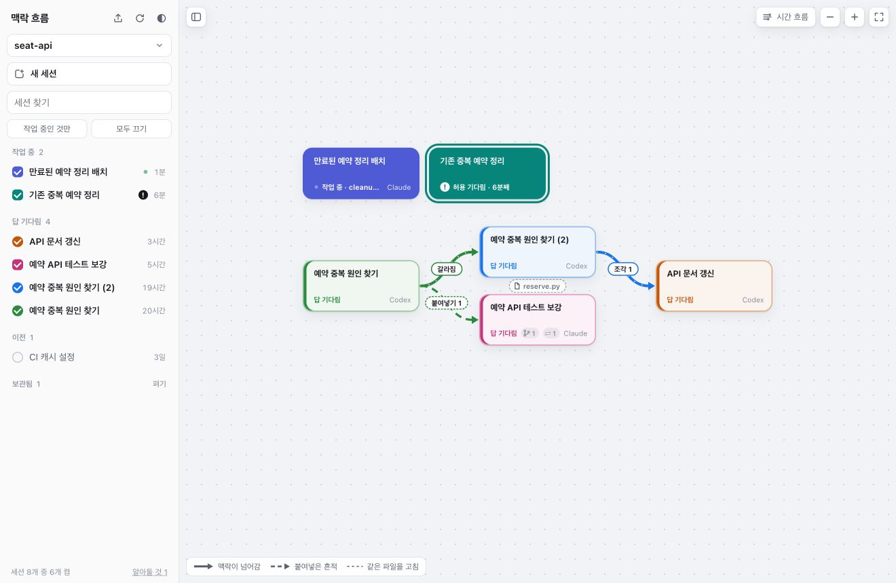
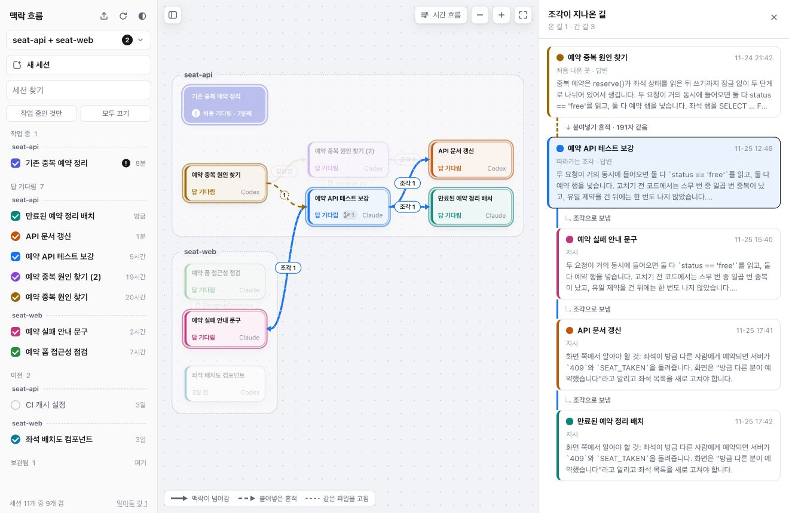
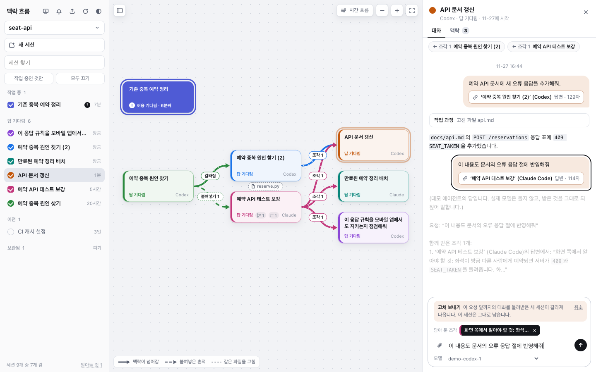

# 맥락 흐름 (context-flow)

코딩 에이전트 세션을 여러 개 함께 돌리면 두 가지를 놓치기 쉽습니다. 어느 세션이 지금 무슨 일을 하고 있는지, 그리고 한 세션에서 나온 결론이 어느 세션으로 넘어갔는지입니다. 맥락 흐름은 Codex와 Claude Code가 이미 남기는 기록을 읽어 세션들을 한 장의 지도로 그리고, 대화에서 고른 글 조각을 그 지도 위에서 다른 세션으로 넘기게 해 줍니다. 기록을 읽고 선을 긋는 데 모델은 쓰지 않습니다.



위는 저장소에 든 데모의 첫 화면입니다. 타일 하나가 세션 하나이고, 선은 세션 사이에 맥락이 넘어간 자리입니다. 왼쪽 위의 색이 채워진 두 타일은 지금 작업 중인 세션이며, 그중 하나는 사람의 허락을 기다리느라 멈춰 있습니다.

## 무엇을 보여 주나

지도는 근거가 얼마나 확실한지에 따라 선을 다르게 긋습니다.

| 지도의 표시 | 뜻 | 근거 |
|---|---|---|
| 실선 화살표 | 맥락이 넘어갔다 | 기록에 남아 있다. 세션을 갈라 냈다, 서브에이전트를 부렸다, 이 도구로 조각을 보냈다 |
| 긴 점선 화살표 | 붙여넣은 흔적 | 사람이 친 요청의 글이 다른 세션의 앞선 답변이나 변경과 80자 이상 같다. 기록된 것이 아니라 찾아낸 것이고, 누르면 같은 구간을 보여 준다 |
| 짧은 점선과 파일 이름 | 같은 파일을 고쳤다 | 화살표가 없다. 맥락이 움직였다는 뜻이 아니다 |

이 지도 위에서 네 가지 일을 합니다.

- **찾기.** 작업 중인 세션, 허락을 기다리는 세션, 답을 받고 멈춘 세션이 한눈에 갈립니다. 타일을 누르면 그 대화가 열립니다. 다른 창에서 나눈 대화는 1~2초 안에 따라오고, 세션이 끝나거나 나를 기다리기 시작하면 알려 줍니다.
- **넘기기.** 대화에서 글을 끌어 골라 담고, 다른 세션에 보내는 말에 붙입니다. 받는 세션이 다른 창에서 작업 중이면 걸어 두었다가 그 세션의 다음 말에 실어 보냅니다.
- **거슬러 가기.** 조각 하나를 고르면 그 글이 처음 나온 세션까지 거슬러 간 길과 그 뒤 퍼져 나간 길이 나옵니다. 프로젝트를 넘어서도 따라갑니다.
- **이어 쓰기.** 지도 옆 대화창에서 그 세션의 대화를 이어 갑니다. 답하는 것은 그 세션의 Codex나 Claude Code 그대로이고, 승인 요청은 화면의 카드로 받습니다. 그림과 파일을 붙이고 모델을 바꿔 보낼 수 있습니다. 보낸 요청을 고쳐 다시 보내면 원래 세션은 그대로 두고 그 요청 앞에서 새 세션이 갈라져 나옵니다. 클라이언트에서 요청을 고치거나 대화를 되감아 버린 말도 대화가 갈린 자리에 접혀 있어 펼쳐 볼 수 있습니다.



위 그림은 화면 프로젝트의 한 세션이 받은 조각을 거슬러 간 모습입니다. 그 글은 API 프로젝트의 다른 세션에서 처음 나왔고, 중간에 한 번은 사람이 손으로 붙여넣었고(점선) 한 번은 이 도구로 보냈습니다(실선).



위 그림은 대화창에서 보낸 요청을 고치는 모습입니다. 그 요청의 글과 함께 갔던 조각이 입력칸으로 돌아오고, 보내면 그 요청 앞까지의 대화만 물려받은 새 세션이 갈라져 나옵니다.

## 처음 공유한 뒤 달라진 것

2026-11-25에 처음 공유한 뒤 아래가 더해졌습니다. 줄마다의 사용법과 갱신하는 법은 [docs/CHANGES.md](docs/CHANGES.md)에 있습니다.

- 다른 창에서 나눈 대화가 1~2초 안에 따라오고, 세션이 끝나거나 나를 기다리면 알려 줍니다.
- 말에 그림과 파일을 붙이고 모델을 바꿔 보냅니다. 지난 대화의 그림도 보입니다.
- 보낸 요청을 고쳐 다시 보내고, 같은 자리에서 갈라진 갈래를 넘겨 봅니다.
- 요청을 고치거나 대화를 되감기 전에 오간 말을 접힌 줄에서 펼쳐 봅니다.
- 화면을 Dock의 앱으로 설치합니다.
- Codex 앱에서 메시지를 고친 스레드, Claude Code에서 되감거나 요약한 세션을 맞게 읽습니다.
- Codex 앱이 없어도 됩니다. Claude Code만 쓰거나 Codex를 CLI로만 써도 프로젝트가 잡힙니다.
- 세션이 하나도 없으면 화면에서 폴더를 골라 첫 세션을 시작합니다.

## 3분 데모

Node.js 23.6 이상만 있으면 됩니다. 데모는 저장소 안에 가짜 기록을 만들어 그것만 읽습니다. 내 Codex·Claude Code 기록은 읽지 않고 모델도 부르지 않습니다.

```sh
git clone https://github.com/jeff8287/context-flow.git
cd context-flow
npm install
npm run demo
```

터미널에 뜨는 주소 `http://127.0.0.1:8802/?project=seat-api`를 브라우저로 엽니다. 좌석 예약 서비스의 중복 예약 버그를 여러 세션이 나눠 고치는 이야기가 들어 있습니다. [docs/DEMO.md](docs/DEMO.md)를 따라 하면 지도 읽기, 조각 넘기기, 역추적, 승인 카드, 요청 고쳐 보내기까지 15분쯤에 직접 해 볼 수 있습니다.

## 내 기록으로 쓰기

```sh
npm install
npm run build
npm run serve          # http://127.0.0.1:8801, 이 컴퓨터에서만 열립니다
```

프로젝트 목록은 Codex 데스크톱 앱의 사이드바 프로젝트에서 가져오고, 그 폴더에서 돈 Claude Code 세션을 함께 읽습니다. Codex 앱을 쓰지 않으면 세션이 일한 폴더(git 작업 폴더)가 프로젝트가 되므로, Claude Code만 써도 그대로 됩니다. 지도를 보고 대화를 이어 쓰는 데에는 이것으로 충분합니다. 다른 창에서 쓰고 있는 세션에 조각을 걸어 두려면 플러그인을 한 번 설치합니다. 서버를 늘 띄워 두고(`npm run service -- install`) 화면 왼쪽 위의 설치 단추를 누르면 Dock의 앱으로도 쓸 수 있습니다. 설치와 화면 기능, 문제 해결은 [docs/USAGE.md](docs/USAGE.md)에 있습니다.

## 문서

| 문서 | 내용 |
|---|---|
| [docs/WHY.md](docs/WHY.md) | 어떤 질문에서 출발했고, 왜 이 방법을 택했고, 지도가 보여 주는 것을 어떻게 읽어야 하는지 |
| [docs/DEMO.md](docs/DEMO.md) | 데모 따라 하기. 단계마다 무엇을 보고 왜 쓸모 있는지 |
| [docs/USAGE.md](docs/USAGE.md) | 설치, 플러그인, 화면 기능, 저장 위치, 문제 해결 |
| [docs/DESIGN.md](docs/DESIGN.md) | 설계 결정과 택하지 않은 안 |
| [docs/ARCHITECTURE.md](docs/ARCHITECTURE.md) | 코드 구조, 데이터의 꼴, 로컬 API |
| [docs/EXPORT.md](docs/EXPORT.md) | 실험용 내보내기 |
| [docs/CHANGES.md](docs/CHANGES.md) | 처음 공유한 뒤 바뀐 것과 갱신하는 법 |
| [plugin/README.md](plugin/README.md) | 걸어 둔 조각을 다음 말에 싣는 훅 |

## 지금 상태

연구용 시제품입니다. macOS에서 Codex(데스크톱 앱, CLI)와 Claude Code로 확인했습니다. Linux는 컨테이너에서 설치, 시험, 데모까지 확인했습니다. 사용자 평가는 아직 하지 않았고, 붙여넣기 찾기의 정확도도 재지 않았습니다. 확인한 것과 하지 못한 것은 [docs/WHY.md의 6절](docs/WHY.md#6-한계와-확인하지-못한-것)에 적었습니다.

코드를 고친 뒤에는 `npm run check && npm test && npm run build`를 돌립니다.
