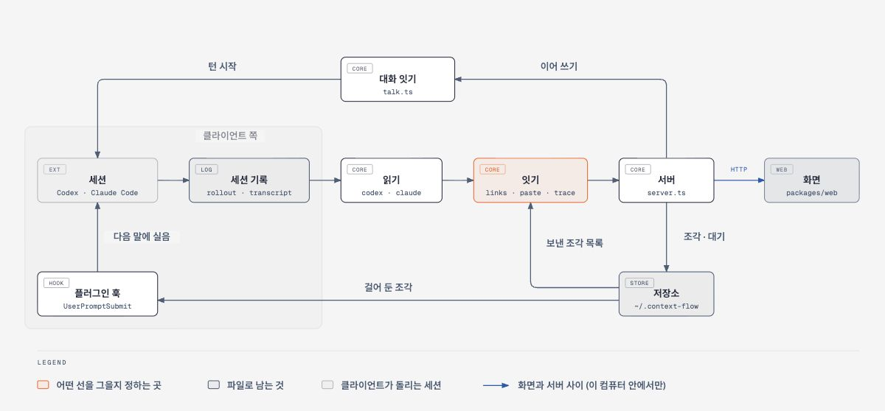

# 구조

코드가 어디에 있고, 부품 사이에 무엇이 오가고, 서버가 무엇을 내주는지를 적습니다.



세션은 클라이언트가 돌리고, 클라이언트는 세션마다 기록 파일을 남깁니다. 코어가 그 기록을 읽어 하나의 꼴로 만들고, 연결을 찾고, 서버가 화면에 내줍니다. 화면에서 건넨 조각은 도구의 저장소에 놓였다가 두 길 가운데 하나로 세션에 들어갑니다. 대화 잇기는 클라이언트를 직접 불러 턴을 시작하고, 플러그인 훅은 사람이 그 세션에 다음 말을 칠 때 조각을 얹습니다. 그림에 그리지 않은 화살표가 둘 있습니다. 화면은 서버에 요청을 보내고(그림에는 서버가 내주는 쪽만 그렸습니다), 훅은 조각을 실은 뒤 그 사실을 저장소에 적습니다.

연결을 찾는 곳은 도구가 보낸 조각의 목록을 그대로 믿지 않습니다. 목록의 조각마다 받은 세션의 기록에서 표식을 찾아, 있을 때만 선으로 만듭니다.

## 폴더

```
packages/core/    기록 읽기, 연결 찾기, 서버. Node가 TypeScript를 바로 돌립니다(빌드 없음)
packages/web/     화면. Vite로 빌드하고 D3를 씁니다
plugin/           두 클라이언트가 함께 쓰는 플러그인. 훅 하나
demo/             지어낸 기록, 두 클라이언트의 대역, 문서의 그림을 찍는 스크립트
docs/             문서. docs/diagrams 에 설명 그림의 원본(HTML)
```

## 코어 (`packages/core/src`)

| 파일 | 하는 일 |
|---|---|
| `model.ts` | 모든 부품이 쓰는 꼴. 여기를 고치면 저장 형식이 바뀝니다 |
| `codex.ts` | Codex의 기록을 읽습니다. 스레드 목록(`state_5.sqlite`), 사이드바 프로젝트, 스레드별 기록 파일. 스레드를 어느 턴 뒤에서 갈라 낼지도 여기서 찾습니다 |
| `claude.ts` | Claude Code의 기록을 읽습니다. 세션별 기록 파일과 서브에이전트. 갈라져 나온 세션의 기록에서 물려받은 부분을, 되감은 대화에서 버려진 턴을 가려냅니다. 세션을 어느 레코드에서 갈라 낼지도 여기서 찾습니다 |
| `projects.ts` | 고를 수 있는 프로젝트. Codex 앱의 사이드바에 있으면 그것, 없으면 세션이 일한 폴더에서 찾은 것(git 작업 폴더마다 하나). 여기에 이 화면에서 프로젝트 밖에 시작한 폴더가 더해지고, 한 폴더에서 시작한 세션이 어느 프로젝트의 것이 될지도 여기서 정합니다(`projectFor`) |
| `snapshot.ts` | 프로젝트 하나(또는 여럿)를 화면이 보는 꼴로 만듭니다. 아래 부품들을 차례로 부릅니다 |
| `links.ts` | 기록된 연결(갈라짐, 서브에이전트, 도착한 조각), 다른 프로젝트와 오간 조각, 같은 파일 겹침. 조각의 표식을 만들고 찾습니다 |
| `paste.ts` | 붙여넣기 찾기. 글을 화면 꼴로 펴고 같은 구간을 찾습니다 |
| `trace.ts` | 조각 하나를 앞뒤로 따라갑니다 |
| `live.ts` | 클라이언트의 살아 있는 프로세스를 보고 '작업 중'과 '기다림'을 정합니다 |
| `watch.ts` | 두 클라이언트의 기록 폴더와 도구의 저장소를 지켜보고, 열어 둔 채 쓰이는 기록은 크기로 봅니다. 어느 변화가 어느 화면에 상관있는지 가립니다 |
| `hooks.ts` | 두 클라이언트에 플러그인이 있는지, Codex에서 승인됐는지 읽습니다 |
| `pictures.ts` | 요청에 붙어 간 그림을 클라이언트의 기록에서 꺼냅니다. 그림이 든 줄이 어디 있는지만 한 번 찾아 두고, 달라고 할 때 그 줄만 읽습니다 |
| `store.ts` | 도구가 스스로 쓰는 것. 보낸 조각, 걸어 둔 조각, 바구니, 말과 함께 보낸 파일, 프로젝트로 적어 둔 폴더, 남은 것 치우기 |
| `talk.ts` | 세션의 클라이언트로 턴 하나를 돌리거나, 새 세션을 시작하거나, 세션을 갈라 냅니다. 두 클라이언트의 사건을 한 가지 작은 사건 흐름으로 바꿉니다 |
| `fresh.ts` | 새 세션이 어느 폴더에서 어떤 모델과 권한으로 시작할지 정합니다. 서버와 화면이 같은 함수를 씁니다 |
| `folders.ts` | 첫 세션이나 프로젝트 밖의 세션을 시작할 폴더 고르기. 폴더 안의 폴더 이름, git 저장소인지, 그 폴더에서 시작하면 어느 폴더가 프로젝트가 되는지, 홈 근처의 git 저장소. 파일의 내용은 읽지 않습니다 |
| `read.ts` | 항목 묶음에 묻는 것(대화, 찾기). 서버와 내보낸 묶음이 같은 함수로 답합니다 |
| `bundle.ts` | 내보내기. 묶음 만들기, 이름 가리기, 묶음 읽기 |
| `standalone.ts` | 빌드된 화면과 묶음을 HTML 한 파일로 만듭니다 |
| `server.ts` | 로컬 API와 화면 파일. 127.0.0.1에만 엽니다 |
| `service.ts` | macOS에서 서버를 launchd에 맡깁니다 |
| `cli.ts` | `scan`, `serve`, `export`, `service` |

## 화면 (`packages/web/src`)

| 파일 | 하는 일 |
|---|---|
| `main.ts` | 전체 틀. 세션 목록, 프로젝트 고르기, 찾기, 내보내기, 기록을 주기적으로 다시 읽기 |
| `map.ts` | 지도. 타일, 선, 이름표, 확대 단계, 타일 끌어 옮기기 |
| `place.ts` | 타일과 테가 어디 서는지. 화면과 떨어진 순수 함수 |
| `route.ts` | 타일을 돌아가는 선의 길. 순수 함수 |
| `chat.ts` | 오른쪽 창. 대화, 입력칸, 조각 담기, 맥락 탭, 승인 카드, 역추적, 새 세션 창 |
| `notice.ts` | 기록을 두 번 읽은 것을 견줘 알릴 것(끝난 세션, 사람을 기다리는 세션)을 찾습니다. 순수 함수 |
| `drag.ts` | 조각을 끌어다 놓기 |
| `lanes.ts` | 시간 흐름 서랍 |
| `state.ts` | 화면이 함께 쓰는 상태와 작은 도우미 |

화면은 코어의 타입과 순수 함수 몇 개(`model.ts`, `read.ts`, `fresh.ts`, `bundle.ts`의 읽기)를 그대로 가져다 씁니다. 그래서 내보낸 묶음을 서버 없이 열어도 같은 답이 나옵니다.

### 앱으로 설치되게 하는 것 (`packages/web/public`)

빌드할 때 화면 옆에 그대로 놓이고 서버가 함께 내줍니다. 내보낸 화면 파일에는 들어가지 않습니다(`standalone.ts`가 이것들을 가리키는 줄을 뺍니다).

| 파일 | 하는 일 |
|---|---|
| `manifest.webmanifest` | 화면이 자기를 소개하는 글. 이름, 시작 주소(`/`), 제 창으로 열 것(`standalone`), 아이콘. 브라우저가 이것을 보고 앱으로 만들어 줍니다 |
| `icon.svg`, `icon-192.png`, `icon-512.png`, `icon-maskable-512.png`, `apple-touch-icon.png` | 아이콘. PNG는 `icon.svg`를 그 크기로 그린 것입니다 |
| `sw.js` | 서비스 워커. 페이지를 달라는 요청에 서버가 답하지 않을 때만 끼어들어 `offline.html`을 대신 내줍니다. 그 밖의 요청은 건드리지 않고, 화면의 코드를 저장해 두지도 않습니다 |
| `offline.html` | '서버가 꺼져 있습니다' 화면. 밖의 것을 하나도 가져오지 않고, 서버가 돌아왔는지만 2.5초마다 묻습니다 |

`main.ts`의 `wireApp`이 서비스 워커를 등록하고 설치 단추를 다룹니다. Chrome과 Edge는 설치할 수 있을 때 `beforeinstallprompt`를 알려 주므로 그때 단추를 보이고, 누르면 브라우저의 설치 창을 띄웁니다. Safari는 알려 주지 않으므로 단추가 메뉴의 어디를 누를지 알려 줍니다. 알릴 것의 수는 `navigator.setAppBadge`로 Dock 아이콘에도 붙입니다.

## 데이터의 꼴

정의는 `packages/core/src/model.ts`에 있습니다. 주요한 것만 적습니다.

| 꼴 | 내용 |
|---|---|
| `Project` | id, 이름, 폴더들. 폴더에서 찾은 프로젝트는 제 폴더 아래에 있는 다른 프로젝트의 폴더(`not`)도 지닙니다. 거기서 일한 세션은 이 프로젝트의 것이 아닙니다. 화면에는 내주지 않습니다 |
| `Session` | id, 클라이언트(`codex` / `claude`), 프로젝트, 작업 폴더, 제목, 모델, 생긴 내력(`user`, `fork`, `spawned`, `subagent`, `side`, `imported`), 부모, 상태(`running`, `waiting`, `idle`, `archived`), 사람을 기다리는 이유(`approval` / `input`), 지금 고치는 파일, 요청·답변·변경의 수 |
| `Item` | 세션에서 맥락을 잘라 낼 수 있는 하나. 종류는 `prompt`, `answer`, `change`. id는 `<세션 id>:<번호>`이고, 한 번 쓴 번호는 다른 항목에 다시 쓰지 않습니다 |
| `Piece` | 항목의 한 구간. 세션, 항목, 시작과 끝 글자 |
| `Link` | 두 세션을 잇는 것. 등급 `recorded` 또는 `paste`. 종류 `fork`, `spawn`, `subagent`, `side`, `import`, `transfer`, `paste`. 양 끝은 세션, 항목, 글자 범위. 붙여넣기에는 맞은 구간들(`parts`)이 달립니다. 갈라짐의 나온 쪽 항목은 원래 세션의 어느 요청 앞에서 갈라졌는지입니다 |
| `Overlap` | 두 세션 이상이 고친 파일과 누가 언제 고쳤는지. 연결이 아닙니다 |
| `Transfer` | 이 도구가 보낸 조각. 도구가 적어 두는 것이고, 받은 기록에 표식이 있을 때만 `Link`가 됩니다 |
| `Gone` | 세션에서 오간 뒤 버려진 말 한 토막(고치거나 되감기 전의 요청과 답)과, 대화의 어느 요청 앞에 보일지. 스냅숏의 항목에 들어가지 않습니다. 조각은 거기서도 잘라 보낼 수 있고, 그 조각의 선은 나온 쪽 항목으로 이 토막의 항목을 가리킵니다 |
| `Waiting` | 걸어 두고 아직 가지 않은 조각 |
| `FarLink` | 지도에 없는 프로젝트의 세션과 오간 조각 |
| `TraceStep` | 역추적의 한 걸음. 방향(뒤로 / 앞으로), 깊이, 따라간 연결 |
| `Snapshot` | 화면이 한 번에 받는 것. 프로젝트, 세션, 글 없는 항목 목록, 연결, 대기, 겹침, 훅 상태, 알아둘 것 |

항목의 글은 스냅숏에 넣지 않고 필요할 때 하나씩 내줍니다. 큰 프로젝트에서도 첫 화면이 가볍도록 하려는 것입니다.

## 프로젝트를 찾는 법 (`projects.ts`)

| 경우 | 프로젝트 |
|---|---|
| Codex 앱의 사이드바에 프로젝트가 있다 | 그 프로젝트들. 앱이 스레드를 넣어 둔 것(`thread-project-assignments`)도 따릅니다 |
| 없다 (Codex를 쓰지 않거나 CLI로만 쓴다), 또는 `CONTEXT_FLOW_PROJECTS=folders` | 세션이 일한 폴더에서 찾습니다 |

폴더에서 찾을 때는 Claude Code의 기록 폴더마다 그 세션들이 일한 폴더를, Codex의 스레드 목록에서 스레드마다 일한 폴더를 모읍니다. Claude Code의 기록 폴더 이름은 일한 폴더의 글자를 `-`로 바꾼 것이라 되돌릴 수 없어서, 그 안의 기록에서 `cwd`를 지닌 첫 레코드를 읽습니다(기록의 앞부분만 읽고, 한 번 찾으면 기억합니다). 폴더마다 위로 올라가며 `.git`이 있는 가장 가까운 폴더를 찾아 그것을 프로젝트의 폴더로 삼고, 없으면 그 폴더 자체입니다. 프로젝트의 id는 폴더 경로의 해시이고, 이름은 폴더 이름이며, 최근에 일한 것이 먼저 옵니다.

이 화면에서 프로젝트 밖의 폴더로 세션을 시작하면(새 세션 창의 '다른 폴더…') 서버가 그 폴더가 든 git 작업 폴더(없으면 그 폴더)를 `~/.context-flow/folders.json`에 적습니다. 세션이 시작된 뒤에만 적습니다. 사이드바가 있을 때는 이 폴더들이 사이드바 프로젝트 뒤에 최근 것부터 붙고, id는 폴더에서 찾은 프로젝트와 같은 해시입니다. 그사이 사이드바 프로젝트 안에 든 폴더는 그 프로젝트의 것이라 빼고, 지워진 폴더도 뺍니다. 사이드바가 없을 때는 적어 둔 때에 세션이 그 폴더에서 일한 것처럼 셉니다. 고른 폴더가 이미 어느 프로젝트 안이면 적지 않고 그 프로젝트의 세션으로 시작합니다. 적어 둔 폴더로만 목록에 있는 프로젝트에는 `kept`가 붙고, 화면은 이것만 목록에서 뺄 수 있습니다. 빼면 `folders.json`에서 그 줄만 지웁니다. 사이드바가 없을 때 세션 기록으로도 잡히는 폴더는 기록 때문에 목록에 있으므로 `kept`가 붙지 않습니다.

홈 폴더에서 돌린 세션이 있으면 홈 폴더가 프로젝트가 되고, 다른 프로젝트는 모두 그 아래에 있습니다. 그래서 폴더에서 찾은 프로젝트는 제 폴더 아래에 있는 다른 프로젝트의 폴더를 함께 지니고(`not`), 읽을 때 그 안의 세션을 뺍니다(`util.ts`의 `within`). 세션 하나는 프로젝트 하나에만 듭니다. 목록은 기록을 읽을 때마다 필요해서 길어야 5초에 한 번만 다시 찾습니다. 이 서버가 새 세션을 시작하면 그 세션이 답하기 시작할 때와 끝날 때 바로 다시 찾습니다.

## Codex의 기록이 여러 파일에 걸칠 때 (`codex.ts`)

Codex는 앱에서 메시지를 고쳐 다시 보내거나 스레드를 갈라 낼 때 기록 파일을 고쳐 쓰지 않고 새 파일을 시작합니다. 새 파일의 첫 줄(`session_meta`의 `history_base`)이 앞선 대화가 어느 파일의 몇 바이트까지인지를 말합니다. 스레드 목록은 가장 새 파일을 가리킵니다.

| 규칙 | 내용 |
|---|---|
| 파일의 id | 파일 이름 끝에 붙은 id. 없으면 스레드의 id입니다. `history_base.thread_id`는 스레드가 아니라 이 id의 파일을 가리킵니다 |
| 같은 스레드의 파일을 가리키면 | 메시지를 고친 것입니다. 그 파일의 그 자리 앞까지가 이 스레드의 앞선 대화이고, 그 뒤(고쳐서 버려진 턴)는 대화가 아닙니다 |
| 다른 스레드의 파일을 가리키면 | 갈라 낸 것입니다. 그 스레드가 부모이고, 그 자리가 갈라진 자리입니다. 부모가 나중에 고쳐져도 갈라진 쪽은 고쳐지기 전의 파일을 계속 가리킵니다 |

`readRollout`은 스레드 목록이 가리키는 파일에서 시작해 같은 스레드의 파일을 거슬러 읽고, 다른 스레드의 파일이 나오면 거기서 멈춥니다. 파일은 이름으로 찾습니다(`recordFiles`). 항목의 번호는 `파일의 차례 × 1,000,000 + 그 파일 안의 자리`입니다. 스레드의 첫 파일은 0번이라 파일 하나짜리 스레드의 번호는 전과 같고, 고쳐서 버려진 턴의 번호는 새 턴에 다시 쓰이지 않습니다. 이 규칙은 이 컴퓨터의 기록 파일 가운데 다른 파일을 가리키는 102개에서 모두 맞았습니다.

고쳐서 버려진 턴은 대화와 따로 읽어 둡니다(`Rollout.gone`). 두 가지입니다.

| 버려진 것 | 어디에 있나 |
|---|---|
| 둘째 뒤의 메시지를 고쳤을 때 | 대화의 길 위에 있는 앞 파일에서, 다음 파일이 가리키는 자리 뒤. 그 자리부터 파일 끝까지만 읽습니다 |
| 첫 메시지를 고쳤을 때 | 새 파일은 아무 파일도 가리키지 않고 새로 시작합니다. 같은 스레드의 더 오래된 파일은 대화의 길 위에 없고, 그 파일 전체가 버려진 것입니다 |

스레드 목록이 가리키는 파일보다 새 파일은 읽지 않습니다(목록이 잠깐 늦을 수 있습니다). 가리키는 파일을 찾지 못해 길을 끝까지 따라가지 못했을 때도 길 밖의 파일은 읽지 않습니다. 그 파일이 버려진 것인지 대화의 앞부분인지 알 수 없기 때문입니다.

## Claude Code에서 되감거나 요약한 대화 (`claude.ts`)

Claude Code는 대화를 되감아도(`/rewind`, Esc 두 번, 헤드리스의 `--resume-session-at`) 기록 파일에서 아무것도 지우지 않습니다. 새 요청의 레코드가 `parentUuid`로 되감은 자리의 레코드를 가리킬 뿐이고, 버려진 요청과 답은 그 사이에 그대로 남습니다. 그래서 대화는 줄이 놓인 차례가 아니라 **마지막 레코드에서 `parentUuid`를 거슬러 간 길**로 읽습니다(`standing`).

| 규칙 | 내용 |
|---|---|
| 어디서 시작하나 | 주 대화의 마지막 user·assistant 레코드. 훅이나 시스템 레코드가 뒤늦게 붙어도 흔들리지 않게 하려는 것입니다 |
| 버려진 턴 | 요청 레코드가 그 길 위에 없으면 그 턴(요청과 다음 요청 전까지의 답·변경)을 대화에서 뺍니다. 턴 단위로 보는 까닭은 병렬 도구 호출의 결과처럼 길에서 벗어나 있어도 멀쩡한 레코드가 흔하기 때문입니다 |
| 맨 처음으로 되감은 것 | 새 요청의 `parentUuid`가 `null`입니다. 길은 거기서 끝나고, 그 앞의 턴은 모두 버려진 것입니다 |
| 부모가 없거나 파일에 없을 때 | 바로 앞에 적힌 레코드로 잇습니다. 요약의 경계(`compact_boundary`)는 부모를 적지 않고, 2.1.220~223은 답 레코드가 가리키는 레코드를 쓰지 않은 일이 턴마다 있었고, 시험과 데모의 기록은 부모를 아예 적지 않습니다. 사슬이 끊겼다고 그 앞을 버리지 않으려는 것입니다 |
| 요약 | 요약 레코드(`isCompactSummary`)는 Claude Code가 쓴 글이라 요청으로 읽지 않습니다. 요약된 턴은 실제로 오간 말이므로 대화에 남습니다 |
| 번호 | 빠진 항목의 번호는 다른 항목에 다시 쓰지 않습니다. 갈라진 세션에서 사본을 빼는 것과 같습니다 |
| 하위 에이전트 | 적용하지 않습니다 |

빠진 턴은 대화와 따로 읽어 둡니다(`Transcript.gone`). 잇달아 버려진 턴은 한 토막이고, 버려진 가지 안에서 다시 되감은 것은 다른 토막입니다.

이 규칙은 Claude Code 2.1.332로 직접 만든 기록(둘째 요청 앞으로 되감기, 맨 앞으로 되감기를 훅이 있을 때와 없을 때, 'Summarize from here', 'Summarize up to here', `/compact`)에서 읽어 낸 것입니다. 이 컴퓨터의 다른 Claude Code 기록 68개는 규칙을 넣기 전과 똑같이 읽힙니다. 한 기록에는 답이 자기 요청보다 먼저 적힌 레코드가 하나 있어, 가리키는 레코드가 파일에서 뒤에 있어도 따라갑니다.

## 버려진 말을 보이는 자리 (`read.ts`의 `goneOf`)

두 클라이언트의 읽기가 내준 토막들은 스냅숏을 만들 때 세션별로 따로 모아 두고(`Built.gone`, 항목 id로 찾는 `Built.left`), 붙여넣기·겹침·수를 만드는 데에는 넘기지 않습니다. 대화를 내줄 때 토막마다 **그 토막이 시작된 시각 뒤에 처음 나온 요청** 앞에 놓습니다. 버려진 말은 그것을 대신한 요청보다 먼저, 그 앞까지의 대화보다 나중에 오갔으므로 시각만으로 자리가 정해집니다. 그런 요청이 없으면 대화의 끝에 놓습니다.

화면(`chat.ts`의 `goneFold`)은 토막을 접힌 한 줄로 그립니다. 고쳐 보내기는 없습니다. 내보내기 묶음에는 넣지 않습니다. 이름 가리기를 거치지 않은 글이 묶음으로 나가지 않게 하려는 것입니다.

**버려진 말에서 자른 조각.** 조각을 자를 때(`server.ts`의 `cut`) 대화의 항목에 없으면 `Built.left`에서 찾으므로, 버려진 말에서도 여느 항목처럼 조각이 나옵니다. 보낸 조각은 받은 기록에 표식이 있으면 선이 되고, 나온 시각은 그 말이 오간 시각입니다. 받는 세션이 그 세션 자신일 수 있습니다. 그런 선은 지도에 그릴 두 끝이 없어서 맥락 탭에만 나옵니다. 화면은 접힌 말에서 담은 조각에 표시(`left`)를 해 두고, 제 세션으로 끌어다 놓는 것을 그런 조각에만 받습니다.

역추적(`trace.ts`)은 `left`를 함께 받아 버려진 말의 글도 읽습니다. 버려진 말에서 시작한 길은 그 조각이 직접 넘어간 곳으로만 나갑니다. 그 세션이 나중에 한 말에 같은 글이 있어도, 그 세션에서 갈라져 나온 세션이 있어도 따라가지 않습니다. 그 말은 세션의 대화에서 이미 빠졌기 때문입니다. 제 세션으로 되보낸 조각은 받은 요청부터 다시 대화의 일부이므로 거기서부터는 여느 조각처럼 따라갑니다. `/api/trace`는 길 위의 자리 가운데 버려진 말인 것(`left`)을 함께 내주어, 화면이 그 자리를 '고치거나 되감기 전의 말'이라고 적습니다.

## 연결이 만들어지는 순서 (`snapshot.ts`)

1. 프로젝트의 Codex 스레드와 Claude Code 세션을 읽어 세션과 항목으로 만듭니다.
2. 세션마다 상태를 정합니다(`live.ts`).
3. 기록된 연결을 만듭니다. 갈라짐, 스레드 생성, 서브에이전트, 곁가지(`links.ts`의 `recordedLinks`).
4. 도구가 보낸 조각 가운데 받은 기록에 표식이 있는 것을 연결로 만듭니다(`transferLinks`). 다른 끝이 지도에 없는 것은 `farLinks`로 따로 둡니다.
5. 붙여넣기를 찾습니다(`paste.ts`의 `pasteLinks`). 갈라져 나온 세션이 물려받은 글은 붙여넣기로 보지 않는데, 물려받은 것은 3단계에서 읽은 갈라진 자리 앞까지입니다. 그 자리를 모르면 갈라진 세션이 시작한 때까지로 봅니다.
6. 같은 파일을 고친 세션들을 찾습니다(`overlaps`).
7. 걸어 둔 조각과 훅의 상태를 읽습니다.

프로젝트 여럿을 한 지도에 올리면 프로젝트를 차례로 읽어 하나로 합친 뒤 3단계부터를 합친 것 위에서 합니다. 그래서 프로젝트를 넘는 조각과 붙여넣기도 보통의 연결이 됩니다.

## 기록이 바뀌면 (`watch.ts`, `/api/events`)

서버는 Codex의 세션 폴더, Claude Code의 프로젝트 폴더와 프로세스 상태 폴더, 도구의 대기함과 보낸 조각 목록을 지켜봅니다. 화면은 `/api/events`에 붙어 있다가 "바뀌었다"는 말을 들으면 스냅숏을 다시 읽습니다. 읽은 것은 기록 파일의 크기와 수정 시각으로 기억해 두므로, 바뀌지 않은 세션은 다시 읽지 않습니다.

폴더를 지켜보는 것만으로는 모자랍니다. macOS는 파일이 쓰였다는 것을 그 파일이 닫힐 때 알려 주는데, Codex는 스레드를 올려 둔 동안 기록 파일을 열어 둔 채로 씁니다. 그래서 서버는 화면이 아는 세션들의 기록 파일 크기를 1초마다 따로 봅니다(`grown`). 폴더 지켜보기는 크기만 봐서는 알 수 없는 것, 곧 방금 생긴 기록과 걸어 둔 조각을 맡습니다. 듣는 화면이 없으면 아무것도 보지 않습니다.

클라이언트는 모든 프로젝트의 기록을 같은 폴더에 씁니다. 그래서 화면마다 상관있는 변화만 알립니다. 그 화면의 세션이 쓰는 기록 파일이면 알립니다. 모르는 파일이면 방금 시작한 세션일 수 있으므로 한 번 알리고, 다시 읽은 스냅숏에도 그 파일이 없으면 남의 것으로 치고 그 뒤로는 넘깁니다. 글이 한꺼번에 쓰일 때는 잠깐 기다렸다가 알리고, 화면 하나에 1초에 한 번을 넘지 않습니다.

화면은 다시 읽은 스냅숏을 앞의 것과 견줘 알릴 것을 찾습니다(`notice.ts`). 작업 중이던 세션이 멈췄거나, 그사이 답이 늘었거나, 세션이 사람을 기다리기 시작한 것입니다.

## 조각의 표식

보내는 조각은 요청 글 뒤에 이런 꼴로 붙습니다.

```
<요청 글>

(아래는 다른 세션에서 골라 온 맥락입니다.)

<context-piece id="cf1a2b3c4d5e6f" from="‘세션 이름’ (Codex)" kind="답변">
조각의 원문
</context-piece>
```

훅으로 가는 조각은 요청 글이 아니라 훅이 더하는 글에 같은 표식으로 들어갑니다. Codex는 그것을 developer 메시지로, Claude Code는 `hook_additional_context` 첨부로 기록에 남깁니다. 어느 쪽이든 받은 세션의 기록에서 id를 찾을 수 있습니다.

## 로컬 API (`server.ts`)

서버는 127.0.0.1에만 엽니다. `/api/` 아래는 Host가 이 서버 자신일 때만 답하고, POST는 Origin이 이 화면이고 본문이 JSON일 때만 받습니다. 다른 사이트의 페이지가 세션에 턴을 시작하게 할 수 없도록 하려는 것입니다.

읽기 (GET)

| 경로 | 내주는 것 |
|---|---|
| `/api/projects` | 프로젝트 목록(`projects`, 이 화면이 더한 것에는 `kept: true`)과, 사이드바의 것인지 폴더에서 찾은 것인지(`from`), 띄울 수 있는 클라이언트(`clients`). 프로젝트가 하나도 없으면 기록을 찾아본 곳(`looked`)도 줍니다 |
| `/api/folders?path=` | 그 폴더 안의 폴더(이름이 점으로 시작하는 것은 빼고)와 git 표시, 위 폴더(`up`), 그 폴더에서 시작한 세션의 프로젝트가 될 폴더(`project`). 그 폴더에서 시작한 세션이 이미 있는 프로젝트의 것이 되면 그 프로젝트(`of`)도 줍니다. `path`가 없거나 `near=1`이면 홈 근처의 git 저장소(`near`)도 줍니다. `near`를 찾을 때 macOS가 앱에 묻는 홈의 폴더(데스크톱, 문서 등)에는 들어가지 않습니다 |
| `/api/snapshot?project=<id[,id]>` | 스냅숏. 프로젝트는 id, 이름, 폴더로 부르고 쉼표로 여럿 |
| `/api/talk?session=<id>` | 한 세션의 항목을 말한 순서로(`items`), 그리고 오간 뒤 버려진 말을 토막마다 어느 요청 앞에 보일지와 함께(`gone`). 긴 글은 잘려 옵니다 |
| `/api/item?id=<항목 id>` | 항목 하나의 전체 글. 버려진 말의 항목도 내줍니다 |
| `/api/find?project=&q=` | 대화의 글에서 찾은 곳 |
| `/api/trace?project=&item=&start=&end=` | 그 구간이 지나온 길(`steps`)과, 길 위의 자리 가운데 버려진 말인 것(`left`) |
| `/api/export?project=&sessions=&as=&mask=1&words=&spots=&theme=&view=1` | 내보낸 파일. `as`는 `html` 또는 `json` |
| `/api/basket` | 담아 둔 조각 |
| `/api/models?client=` | 그 클라이언트가 내주는 모델. Codex에는 앱 서버의 `model/list`로 묻습니다 |
| `/api/events?project=` | 그 프로젝트의 기록이 바뀌었다는 알림(SSE). 바뀌었다는 것만 말하고, 화면이 스냅숏을 다시 읽습니다 |
| `/api/turn/active?session=` | 이 서버가 그 세션에서 돌리는 턴이 있으면 그 id |
| `/api/picture?item=&n=` | 요청에 붙어 간 그림 하나. 클라이언트의 기록에서 꺼냅니다. Claude Code는 요청 레코드의 `image` 블록, Codex는 그 턴에 모델로 간 것(`response_item`의 `input_image`)에서입니다 |
| `/api/attached?item=&n=` | 요청과 함께 보낸 파일 하나. 이 도구가 `uploads/`에 둔 파일만 내줍니다 |
| `/api/turn/stream?turn=` | 턴의 사건 흐름(SSE). 늦게 붙어도 처음부터 다시 틀어 줍니다 |

쓰기 (POST)

| 경로 | 하는 일 |
|---|---|
| `/api/send` | 세션에 말을 보냅니다. 붙인 조각과 그 세션에 걸려 있던 조각이 함께 갑니다. `files`(이름, 종류, base64)와 `model`도 받습니다. 작업 중인 세션이면 409 |
| `/api/new` | 새 세션을 시작합니다. `project` 없이 `cwd`만 주면 첫 세션이고, 그 폴더에서 클라이언트의 기본 권한으로 시작합니다. 모델은 `model`로 주고, 주지 않으면 클라이언트의 기본 모델입니다. 첫 세션에는 조각을 붙일 수 없습니다. `project`와 함께 준 `cwd`가 지도의 프로젝트 밖이면 그 폴더가 든 프로젝트의 세션이 되고, 어느 프로젝트에도 없으면 그 폴더를 새 프로젝트로 적어 둡니다. 맨 위 폴더와 없는 폴더는 400입니다. 돌려주는 `project`는 세션이 든 프로젝트이고, 화면은 그것이 지도에 없으면 함께 올립니다. 돌려주는 `model`은 준 모델, 없으면 따른 세션의 모델입니다 |
| `/api/projects/forget` | 이 화면이 더한 프로젝트(`kept`)를 목록에서 뺍니다. `folders.json`의 그 줄만 지우고 기록은 건드리지 않습니다. 그런 프로젝트가 아니면 400이고, 바뀐 목록을 돌려줍니다 |
| `/api/fork` | 세션의 요청 하나(`item`)를 고친 글(`text`)로 다시 보냅니다. 세션을 그 요청 앞에서 갈라 내고, 갈라진 세션에 보냅니다. 조각, `files`, `model`은 `/api/send`와 같습니다. 돌려주는 `from`은 갈라 낸 세션이고, 물려받을 것이 없었으면 null입니다 |
| `/api/queue`, `/api/queue/cancel` | 조각을 걸어 두고, 거둡니다. 턴을 시작하지 않습니다 |
| `/api/basket` | 바구니를 저장합니다 |
| `/api/turn/answer` | 승인 요청에 허용 또는 거절로 답합니다 |
| `/api/turn/stop` | 턴을 멈춥니다 |

턴의 사건은 두 클라이언트 모두 같은 꼴로 옵니다. `prompt`, `text`(답의 조각), `break`(새 메시지), `step`(명령·변경·도구), `ask`(승인 요청), `answered`, `done`입니다.

## 대화 잇기 (`talk.ts`)

| | Codex | Claude Code |
|---|---|---|
| 붙는 법 | 앱 서버를 띄워 JSON-RPC로. `thread/resume` 또는 `thread/start`, 그다음 `turn/start` | 화면 없는 실행에 stream-json 입출력. `--resume` 또는 `--session-id` |
| 모델과 권한 | 기록의 마지막 턴에서 모델, 승인 정책, 샌드박스를 읽어 그대로 | 세션의 모델. 권한 요청을 표준 입출력으로 돌림 |
| 승인 요청 | 서버가 보내는 승인 요청에 `accept` / `decline` | `control_request`(`can_use_tool`)에 allow / deny |
| 답의 흐름 | `item/agentMessage/delta` | `stream_event` |
| 그림 | `turn/start`의 입력에 `localImage`(파일 경로) | 요청의 내용에 base64 `image` 블록 |
| 그 밖의 파일 | 말 뒤에 경로를 적음 | 말 뒤에 경로를 적고 `--add-dir`로 그 폴더를 읽게 함 |
| 다른 모델 | `thread/resume`과 `turn/start`의 `model` | `--model` |
| 갈라 내기 | `thread/fork`에 `lastTurnId`(남길 마지막 턴) | `--resume <원래 세션> --fork-session --session-id <새 id> --resume-session-at <남길 마지막 답의 레코드 uuid>` |

### 요청을 고쳐 보내기 (`/api/fork`)

원래 세션의 기록에는 아무것도 쓰지 않습니다. 고칠 요청 앞에서 세션을 갈라 내는 일은 그 세션의 클라이언트가 하고, 서버는 어디서 갈라 낼지만 기록에서 찾아 줍니다.

| | Codex (`codex.ts`의 `forkPoint`) | Claude Code (`claude.ts`의 `stoodBefore`) |
|---|---|---|
| 남길 마지막 자리 | 그 요청 앞 턴의 id(`turn_id`) | 그 요청에서 대화가 온 길을 거슬러 처음 만나는 답 레코드의 `uuid`. 요약이 먼저 나오면 요약 레코드, 요약이 끝부분을 그대로 남겼으면 그 부분의 마지막 답 |
| 갈라진 세션의 기록 | 첫 줄에 `forked_from_id`와 `history_base`(어느 스레드의 기록 몇 바이트까지를 물려받았는지). 물려받은 항목은 복사되지 않습니다 | `derived-from` 줄(온 길 전체, 가까운 세션이 마지막)과 원래 세션 레코드의 사본으로 시작합니다. 읽을 때 원래 기록에 있는 `uuid`의 항목은 뺍니다 |
| 갈라진 세션의 첫 요청을 또 고칠 때 | `history_base`를 따라가 원래 스레드를 같은 자리에서 다시 갈라 냅니다 | 갈라진 세션을 사본 끝에서 갈라 냅니다 |

**어디서 갈라졌는지 읽기.** 갈라짐 선은 원래 세션의 어느 요청 앞에서 갈라졌는지를 지닙니다(`links.ts`의 `forkedBefore`). Codex는 갈라진 기록의 `history_base`가 가리키는 자리 앞의 마지막 턴에서, Claude Code는 갈라진 기록에 사본으로 든 마지막 요청에서 찾습니다. 그 다음 요청이 '갈라지기 직전의 요청'입니다. 원래 세션이 모든 말을 마친 뒤 갈라졌으면 그런 요청이 없고, 선은 그것을 지니지 않습니다. 화면은 이것으로 같은 자리에서 갈라진 갈래들을 묶어 요청 아래에 '2/3'을 보이고(`chat.ts`의 `waysFrom`), 역추적은 그 요청 앞에 나온 조각만 갈라진 세션으로 따라갑니다.

그 요청 앞에 아무 말도 없으면(세션의 첫 요청) 갈라 낼 것이 없으므로 `/api/new`처럼 그 세션을 닮은 새 세션을 시작합니다. 어디서 갈라 낼지 기록이 말해 주지 않으면(턴 표시가 없는 옛 Codex 기록) 400으로 답하고 아무것도 시작하지 않습니다.

Claude Code는 대화를 마지막 요약부터만 다시 잡습니다. 요약보다 앞의 레코드나 되감아 버려진 레코드를 `--resume-session-at`에 주면 "No message found with message.uuid"로 끝납니다. 그래서 `stoodBefore`는 그런 요청을 미리 가려 `summed`(요약한 자리보다 앞)와 `back`(되감아 버려진 것)으로 답하고, 서버는 까닭을 적어 400으로 답합니다. 요약 바로 뒤의 요청을 고쳐 갈라 낸 세션은 사본에 요청이 하나도 없어서, 갈라짐 선이 어느 요청 앞인지를 지니지 못합니다.

## 플러그인 (`plugin/`)

`plugin/context-flow/hooks/hooks.json`이 `UserPromptSubmit`에 `along.sh`를 겁니다. `along.sh`는 걸린 조각이 어디에도 없으면 node를 띄우지 않고 끝납니다. 있으면 `along.mjs`가 그 세션 몫을 꺼내 길이를 맞춰 `additionalContext`로 내고, 가져간 것을 `transfers.jsonl`에 적습니다. 자세한 것은 [plugin/README.md](../plugin/README.md)에 있습니다.

## 데모 (`demo/`)

| 파일 | 하는 일 |
|---|---|
| `world.ts` | 데모의 가짜 세계. 폴더, 프로젝트, 세션의 이름. 도구가 `demo/home`만 보게 하는 환경 변수 |
| `make.ts` | 두 클라이언트의 실제 형식으로 기록을 씁니다. 다 쓴 뒤 도구로 다시 읽어 이야기대로 연결이 나오는지 스스로 확인합니다 |
| `agent.ts` | 두 클라이언트의 대역. 같은 프로토콜로 말하고, 같은 훅을 부르고, 같은 형식으로 기록합니다. 모델 대신 받은 것을 되짚어 답합니다 |
| `stage.ts` | `npm run demo`와 `demo:shots`가 함께 쓰는 준비. 기록을 만들고, 대역을 클라이언트 자리에 걸고, 작업 중인 두 세션의 상태 파일을 씁니다 |
| `run.ts` | `npm run demo`. `stage.ts`로 준비하고 서버를 띄웁니다 |
| `shots.ts` | `npm run demo:shots`. 데모를 자기 기록 폴더로 띄우고, DEMO.md의 단계를 헤드리스 Chrome으로 눌러 가며 `docs/img`의 그림을 찍습니다. 단계가 문서대로 나오지 않으면 멈춥니다 |
| `chrome.ts` | `shots.ts`가 쓰는 작은 Chrome 드라이버. 의존성 없이 디버깅 포트(CDP)로 열고, 누르고, 치고, 끌고, 찍습니다 |
| `demo.test.ts` | 데모의 기록이 이야기대로 읽히는지, 걸어 둔 조각이 두 클라이언트의 세션에 실리는지 |

## 시험

```sh
npm test
```

60개이고 모두 지어낸 기록으로 돕니다. 실제 클라이언트를 부르는 시험은 없습니다. 데모의 시험 하나는 127.0.0.1의 빈 포트에 서버를 잠깐 띄웁니다.

| 파일 | 수 | 다루는 것 |
|---|---|---|
| `packages/core/test/core.test.ts` | 46 | 글 펴기와 자리 되돌리기, 버려진 말에서 자른 조각의 선과 역추적, 사이드바가 없을 때 폴더에서 프로젝트 찾기, 붙여넣기로 보는 것과 보지 않는 것, 역추적, 조각의 도착과 대기, 프로젝트 사이 조각, 새 세션, 갈라진 세션 읽기와 갈라 낼 자리 찾기, 어디서 갈라졌는지 읽기, 여러 파일에 걸친 Codex 기록 읽기, 되감거나 요약한 Claude Code 대화 읽기, 버려진 말을 따로 읽어 제자리에 두기, 작업 중 판정, 내보내기와 이름 가리기, 남은 것 치우기, 앱으로 설치되게 하는 파일들, 기록에서 그림 꺼내기 |
| `packages/web/test/map.test.ts` | 6 | 타일과 테의 배치, 타일을 돌아가는 선, 알릴 것 찾기 |
| `demo/demo.test.ts` | 8 | 데모의 기록과 훅 전달, 기록이 바뀌면 화면에 알리는 것, 그림·파일·모델을 실어 보내고 다시 꺼내는 것, 요청을 고쳐 갈라 보내는 것, 고치거나 되감은 세션이 버려진 말과 함께 읽히고 계속 이어 쓰이는 것, 버려진 말의 조각을 다른 세션과 제 세션에 보내는 것, 프로젝트가 없을 때 고른 폴더에서 첫 세션을 시작하는 것, 지도의 프로젝트 밖 폴더(다른 프로젝트, 새 저장소)에서 시작하는 것 |
