# 데모 따라 하기

저장소에 든 데모로 맥락 흐름의 기능을 처음부터 끝까지 직접 해 봅니다. 15분쯤 걸립니다. 단계마다 무엇을 하는지, 화면에 무엇이 보이는지, 그것이 왜 쓸모 있는지를 적었습니다.

## 준비

Node.js 23.6 이상이 필요합니다(`node --version`). Codex나 Claude Code는 없어도 됩니다.

```sh
npm install
npm run demo
```

터미널에 주소 둘이 뜹니다. 첫째 주소 `http://127.0.0.1:8802/?project=seat-api`를 브라우저로 엽니다. 8802 포트를 다른 것이 쓰고 있으면 `npm run demo -- --port 9000`처럼 바꿉니다. 저장소는 `/tmp` 같은 임시 폴더 밖에 받아 주세요. 이 도구는 임시 폴더의 파일을 두 세션이 함께 고친 파일로 세지 않아서, 거기서는 데모가 시작하지 않고 이유를 알려 줍니다.

데모에 대해 알아 둘 것이 셋 있습니다.

- **내 기록을 읽지 않습니다.** 데모는 `demo/home` 폴더에 가짜 기록을 만들고 도구가 그 폴더만 보게 합니다. `~/.codex`, `~/.claude`, `~/.context-flow`는 건드리지 않습니다.
- **모델이 돌지 않습니다.** 세션에 말을 보내면 '데모 에이전트'가 답합니다. 받은 요청과 함께 온 조각을 그대로 되짚어 말할 뿐입니다. 그래서 조각이 정말 도착했는지를 답에서 바로 확인할 수 있습니다.
- **다시 시작하면 처음으로 돌아갑니다.** `npm run demo`를 다시 돌리면 기록을 지우고 새로 만듭니다. 마음껏 눌러 보세요.

## 이야기

좌석 예약 서비스에 같은 좌석이 두 번 예약되는 버그가 있습니다. API 프로젝트 `seat-api`와 화면 프로젝트 `seat-web`에서 여러 세션이 이 일을 나눠 맡았습니다.

| 프로젝트 | 세션 | 클라이언트 | 한 일 |
|---|---|---|---|
| seat-api | 예약 중복 원인 찾기 | Codex | 원인을 찾았다 |
| seat-api | 예약 중복 원인 찾기 (2) | Codex | 위 세션에서 갈라져 나와 코드를 고쳤다 |
| seat-api | 예약 API 테스트 보강 | Claude Code | 원인 분석을 손으로 붙여넣어 받고 재현 테스트를 만들었다 |
| seat-api | API 문서 갱신 | Codex | 새 오류 응답을 조각으로 받아 문서에 넣었다 |
| seat-api | 만료된 예약 정리 배치 | Claude Code | 지금 작업 중이다 |
| seat-api | 기존 중복 예약 정리 | Claude Code | 명령을 돌려도 되는지 허락을 기다리고 있다 |
| seat-api | CI 캐시 설정 | Codex | 사흘 전의 무관한 일 |
| seat-api | 로깅 형식 정리 | Codex | 보관된 세션 |
| seat-web | 예약 실패 안내 문구 | Claude Code | API 프로젝트에서 조각을 받아 안내 문구를 넣었다 |
| seat-web | 예약 폼 접근성 점검 | Claude Code | 위 세션과 같은 파일을 고쳤다 |
| seat-web | 좌석 배치도 컴포넌트 | Codex | 사흘 전의 무관한 일 |

## 1. 지도를 읽는다

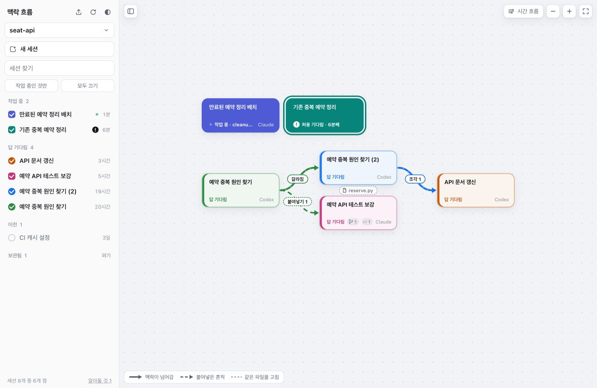

**보이는 것.** 왼쪽은 세션 목록이고 가운데가 지도입니다. 목록은 상태별로 묶여 있습니다. '작업 중' 둘, '답 기다림' 넷, '이전' 하나, '보관됨' 하나입니다. 지도에는 작업 중이거나 최근에 답을 받은 세션, 그리고 거기 이어진 세션이 타일로 올라와 있습니다.

- 색이 채워진 타일 둘이 작업 중인 세션입니다. '만료된 예약 정리 배치'는 지금 `cleanup.py`를 고치는 중이고, '기존 중복 예약 정리'는 '!'와 함께 '허용 기다림'이라고 적혀 있습니다. 데모를 띄운 지 2분이 넘으면 앞의 타일은 '작업 중 · N분째 조용'으로 바뀝니다. 작업 중이지만 그동안 기록에 새로 적힌 것이 없다는 뜻입니다.
- '예약 중복 원인 찾기'에서 '(2)'로 가는 실선 **갈라짐**은 둘째 세션이 첫째에서 갈라져 나왔다는 기록입니다.
- '(2)'에서 'API 문서 갱신'으로 가는 실선 **조각 1**은 이 도구로 조각 하나를 보냈고 그것이 도착했다는 기록입니다.
- '예약 중복 원인 찾기'에서 '예약 API 테스트 보강'으로 가는 긴 점선 **붙여넣기 1**은 기록에는 없고 글자를 견줘 찾아낸 연결입니다.
- '(2)'와 '예약 API 테스트 보강' 사이의 짧은 점선과 `reserve.py`는 두 세션이 같은 파일을 고쳤다는 표시입니다. 화살표가 없습니다.
- '예약 API 테스트 보강' 타일 아래의 작은 표시 둘은 이 세션이 부린 서브에이전트 하나, 그리고 다른 프로젝트와 주고받은 조각 하나(⇄ 1)입니다.

**해 볼 것.**

- 타일에 마우스를 올리면 그 세션에 마지막으로 한 요청과 이어진 세션이 카드로 뜹니다.
- 목록에서 'CI 캐시 설정'을 누르면 지도에 올라옵니다. 어디에도 이어지지 않은 타일입니다. 다시 누르면 내려갑니다.
- 목록 위의 '작업 중인 것만'은 처음 상태로 돌립니다.

**왜 쓸모 있나.** 세션을 여럿 돌릴 때 먼저 알아야 하는 것은 누가 일하고 누가 나를 기다리는지입니다. 세션 목록을 하나씩 열지 않고 한 화면에서 갈립니다. '허용 기다림'은 사람이 가지 않으면 풀리지 않는 유일한 상태라서 따로 눈에 띄게 그립니다.

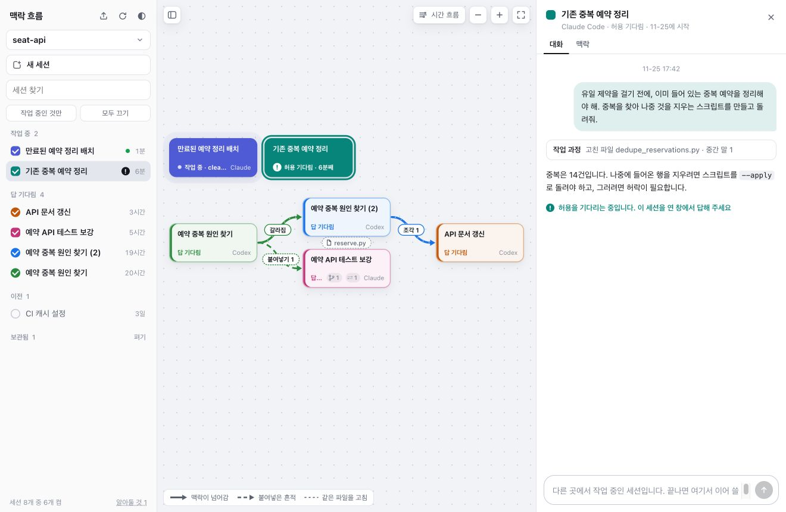

'기존 중복 예약 정리' 타일을 누르면 그 대화가 열립니다. 이 세션은 다른 창(터미널)에서 돌고 있으므로 이 화면에서는 허락해 줄 수 없고, 그렇다고 화면이 말해 줍니다.

## 2. 점선의 근거를 본다

지도에서 이름표 **붙여넣기 1**을 누릅니다.

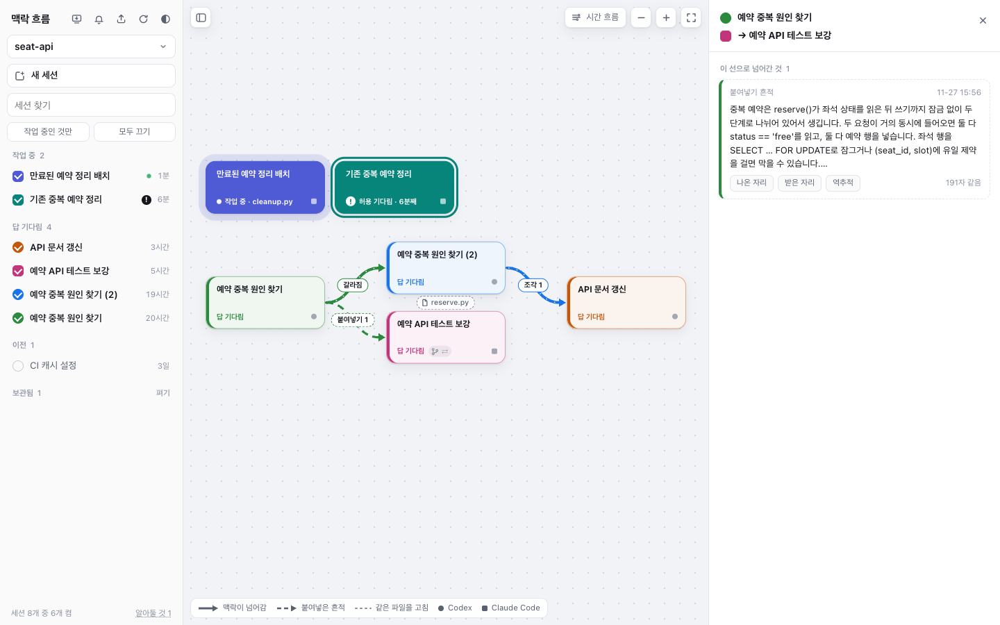

**보이는 것.** 오른쪽에 '이 선으로 넘어간 것'이 열리고 '붙여넣기 흔적' 카드가 하나 있습니다. 같은 글과 '191자 같음'이 적혀 있습니다. 카드의 **받은 자리**를 누르면 '예약 API 테스트 보강'의 첫 요청이 열리고 같은 구간이 칠해져 나옵니다.

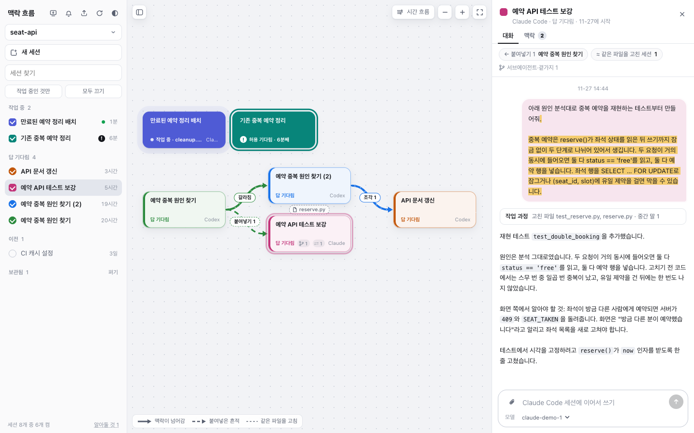

같은 카드의 **나온 자리**를 누르면 '예약 중복 원인 찾기'의 답변에서 같은 구간이 칠해집니다. 두 글을 견줘 보세요. 답변 쪽은 굵은 글씨와 코드 표시가 있고, 요청 쪽은 그것들이 빠진 맨글입니다. 사람이 화면에서 복사해 붙였기 때문입니다.

**왜 쓸모 있나.** 이 연결은 어느 기록에도 적혀 있지 않습니다. 원인을 찾은 세션은 Codex이고 테스트를 만든 세션은 Claude Code라서 두 클라이언트의 세션 목록 어디에서도 둘은 무관해 보입니다. 지도는 글자를 견줘 이 연결을 찾아내고, 추정이라는 것을 점선으로 밝히고, 근거 구간을 보여 줍니다. 믿을지는 보는 사람이 정합니다.

## 3. 대화에서 글을 골라 담는다

지도에서 '예약 API 테스트 보강' 타일을 눌러 대화를 엽니다. 답변에서 "화면 쪽에서 알아야 할 것"으로 시작하는 문단을 마우스로 끌어 고릅니다.

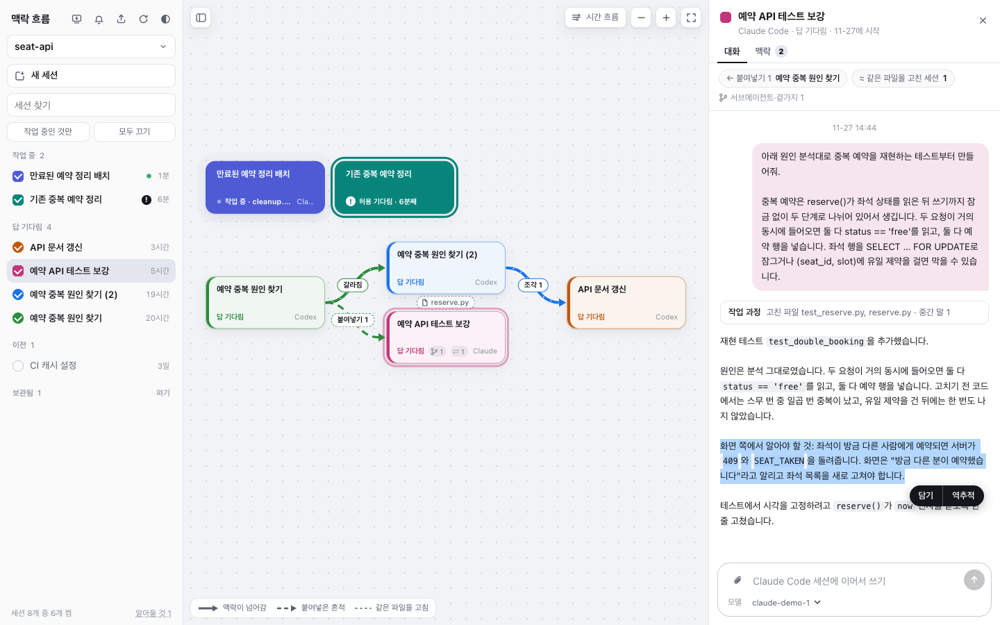

**보이는 것.** 고른 글 옆에 '담기'와 '역추적' 단추가 뜹니다. **담기**를 누르면 입력칸 위에 '담아 둔 조각'으로 칩이 생깁니다. 답변 전체를 담으려면 그 답변 오른쪽 위의 '담기'를 누릅니다.

**왜 쓸모 있나.** 다른 세션에 넘기고 싶은 것은 대개 긴 답변 전체가 아니라 그 가운데 결론 한 문단입니다. 조각은 어느 세션의 어느 답변, 몇 번째 글자부터 몇 번째 글자까지인지를 지니고 다닙니다. 그래서 나중에 이 조각이 어디서 왔는지를 물을 수 있습니다.

## 4. 다른 세션에 붙여 보낸다

지도에서 'API 문서 갱신' 타일을 누릅니다. 입력칸 위의 칩을 눌러 이 말에 붙이고(칩이 검게 바뀝니다), 할 말을 적습니다. 예를 들면 "이 내용도 문서의 오류 응답 절에 반영해줘"입니다.

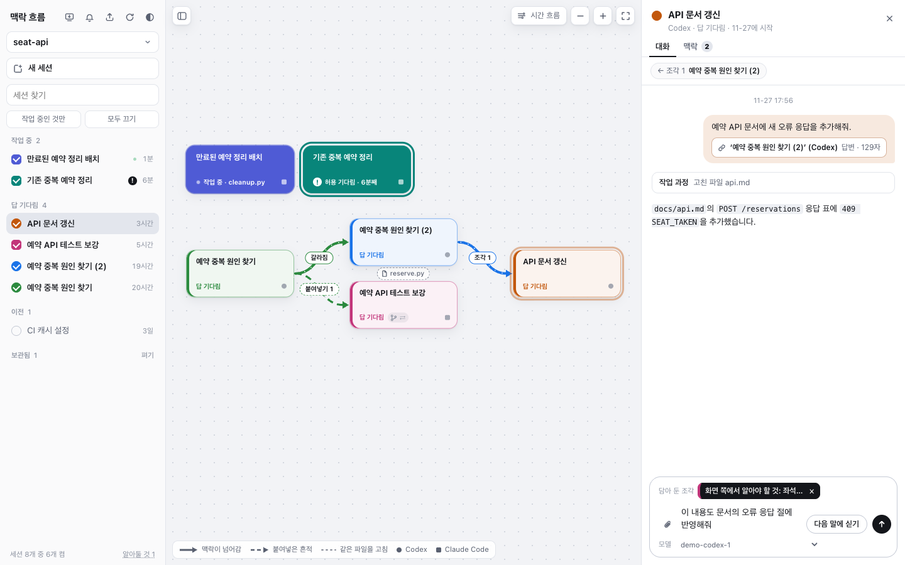

Enter를 누르거나 화살표 단추로 보냅니다.

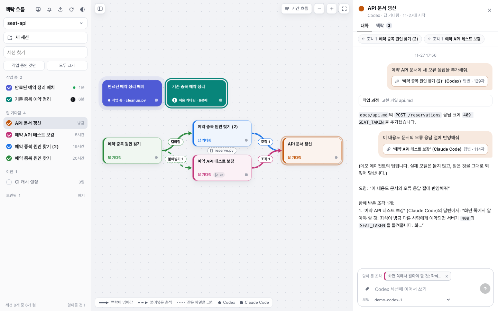

**보이는 것.** 보낸 말 아래에 함께 간 조각이 접힌 줄로 붙어 있습니다. 데모 에이전트의 답이 "함께 받은 조각 1개"와 그 내용의 앞머리를 되짚습니다. 지도에는 '예약 API 테스트 보강'에서 'API 문서 갱신'으로 가는 실선 **조각 1**이 새로 생겼습니다. 그 이름표를 누르면 넘어간 조각이 나옵니다.

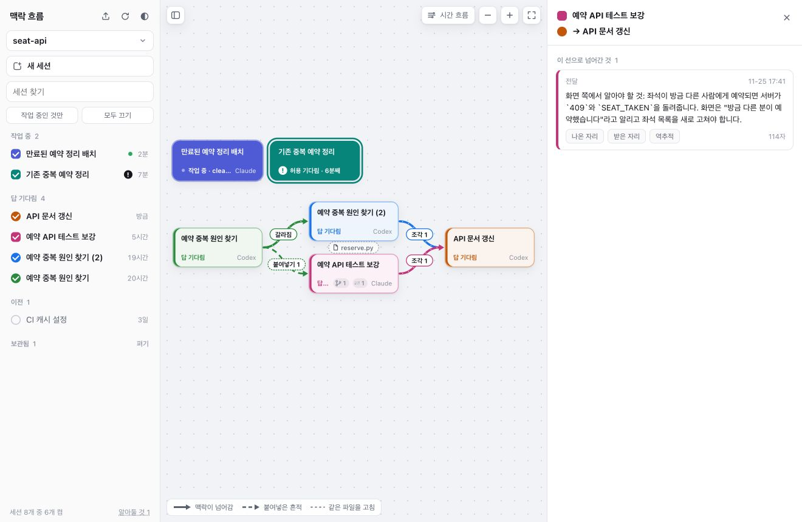

칩을 누르는 대신 끌어서 지도의 타일에 놓아도 됩니다. 놓으면 그 세션의 입력칸에 붙은 채로 대화가 열립니다. 놓는 것만으로는 아무것도 보내지 않습니다.

**왜 쓸모 있나.** 실선은 도구가 "보냈다"고 적어서 그려진 것이 아닙니다. 받은 세션의 기록에 그 조각이 실려 있는 것을 확인하고 그린 것입니다. 답이 조각을 되짚는 것과 실선이 생기는 것이 같은 사실을 두 군데서 보여 줍니다. 실제 사용에서는 이 자리에 Codex나 Claude Code의 답이 옵니다.

## 5. 작업 중인 세션에는 걸어 둔다

지도에서 '만료된 예약 정리 배치' 타일을 누릅니다. 이 세션은 다른 창에서 작업 중이라 입력칸이 잠겨 있습니다. 칩을 눌러 붙이면 **다음 말에 싣기** 단추가 나옵니다. 누릅니다.

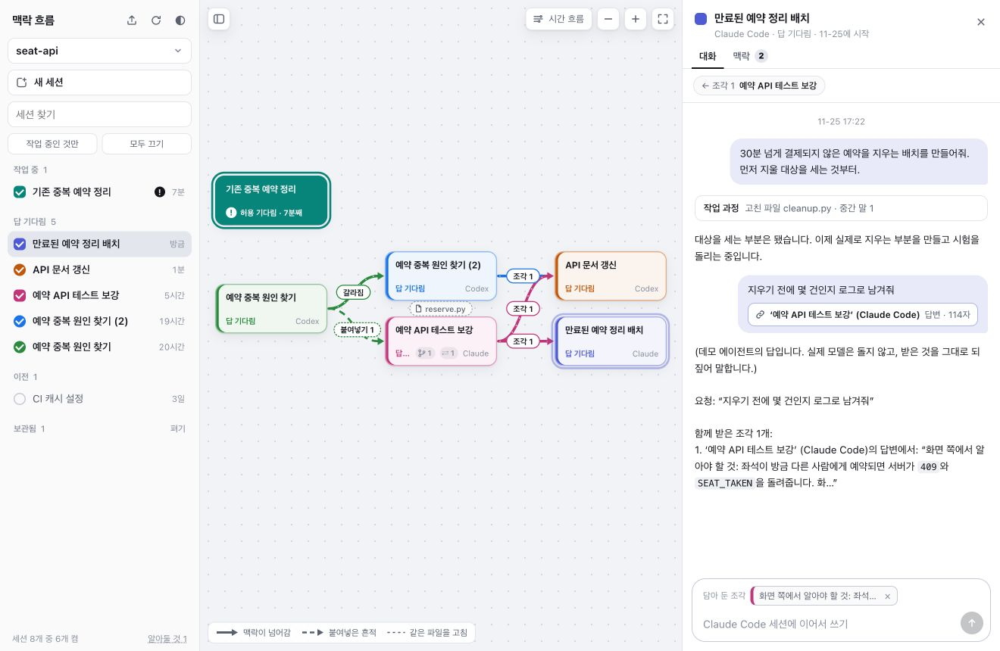

**보이는 것.** 지도에 끊어진 선과 **대기 1**이 생깁니다. 아직 아무것도 가지 않았다는 뜻입니다. 입력칸 위에 "이 세션에 다음 말을 치면 함께 갑니다"라는 띠가 생깁니다. 띠의 '보기'를 누르면 걸어 둔 조각이 나오고, 거기서 '대기 취소'로 거둘 수 있습니다.

이제 그 세션의 '자기 창'에서 말을 칩니다. 실제로는 Claude Code를 돌리는 터미널이나 Codex 데스크톱 앱에서 치는 것이고, 데모에서는 다른 터미널을 열어 다음 명령으로 대신합니다.

```sh
npm run demo:say -- batch "지우기 전에 몇 건인지 로그로 남겨줘"
```

터미널에 "훅이 걸려 있던 조각 1개를 이 말과 함께 실었습니다"가 나옵니다. 서버가 기록 폴더를 지켜보고 있어서 화면이 곧바로 따라옵니다.

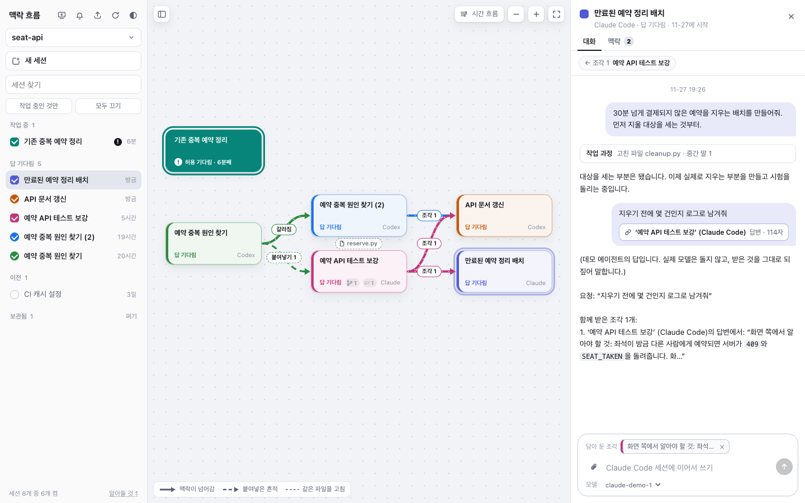

**보이는 것.** 끊어진 선이 실선 **조각 1**로 바뀌었습니다. 대화에는 터미널에서 친 말이 올라와 있고 조각이 붙어 있습니다. 세션은 '작업 중'에서 '답 기다림'으로 옮겨 갔습니다. 이 대화를 열어 두지 않았다면 지도 오른쪽 위에 '끝났습니다' 카드도 뜹니다(10절의 알림).

**왜 쓸모 있나.** 세션은 대개 다른 창이 쥐고 있고, 작업 중인 세션에 끼어들 수도 없습니다. 걸어 두면 사람이 그 세션에 다음 말을 걸 때 조각이 따라갑니다. 이때 불리는 것은 저장소의 실제 플러그인 훅(`plugin/context-flow/hooks/along.sh`)입니다. 데모는 클라이언트를 흉내 낼 뿐 훅은 진짜입니다.

`demo:say`의 첫 인자는 세션의 짧은 이름입니다. `cause`, `fix`, `tests`, `batch`, `docs`, `dedupe`, `ci`, `logs`, `message`, `map`, `form`이 있고, 인자 없이 돌리면 목록이 나옵니다.

## 6. 조각이 지나온 길을 거슬러 간다

왼쪽 위의 프로젝트 단추(seat-api)를 눌러 목록을 열고, `seat-web` 앞의 네모를 누릅니다. 두 프로젝트가 한 지도에 올라옵니다. 주소로는 `?project=seat-api,seat-web`입니다.

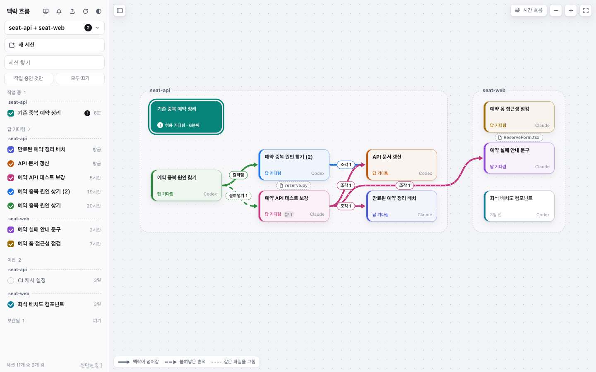

**보이는 것.** 프로젝트마다 점선 테와 이름이 있습니다. seat-api의 '예약 API 테스트 보강'에서 seat-web의 '예약 실패 안내 문구'로 실선 **조각 1**이 테를 넘어갑니다. seat-web 안에는 두 세션이 `ReserveForm.tsx`를 함께 고쳤다는 겹침 표시가 있습니다. (위 그림은 4단계와 5단계를 하기 전의 모습이라 선이 둘 적습니다.)

테를 넘는 **조각 1**을 누르고, 열린 카드에서 **역추적**을 누릅니다.

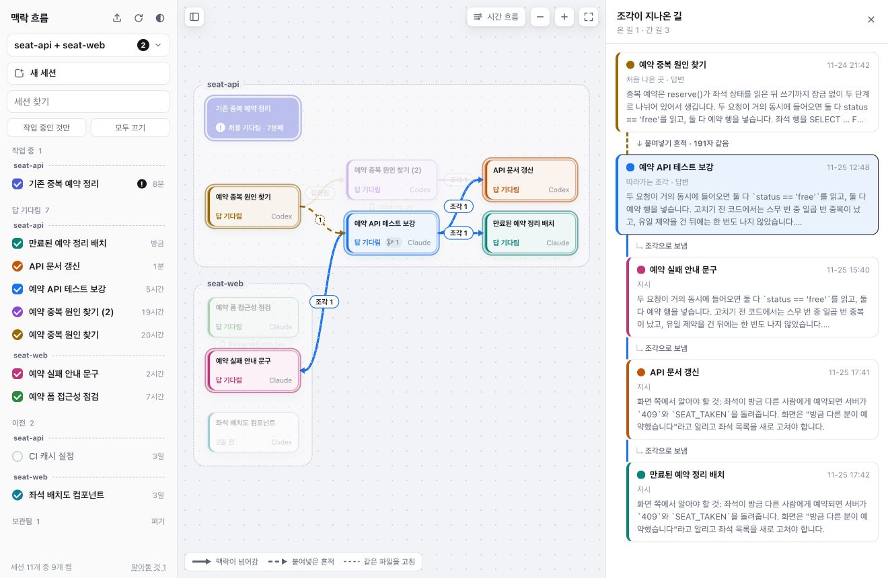

**보이는 것.** 오른쪽에 '조각이 지나온 길'이 열립니다. 위에서부터 읽습니다.

1. **예약 중복 원인 찾기** (처음 나온 곳). 이 글이 가장 먼저 나온 답변입니다.
2. 점선 "붙여넣기 흔적 · 191자 같음". 사람이 손으로 옮긴 걸음입니다.
3. **예약 API 테스트 보강** (따라가는 조각). 받은 원인 분석을 제 답변에 다시 적었습니다.
4. 실선 "조각으로 보냄"이 세 갈래로 갑니다. seat-web의 '예약 실패 안내 문구', 그리고 4단계와 5단계에서 직접 보낸 'API 문서 갱신'과 '만료된 예약 정리 배치'입니다.

지도에서는 이 길 위의 세션만 진하게 남습니다. 카드를 누르면 그 대화의 그 자리가 열립니다.

**왜 쓸모 있나.** "화면에 넣은 이 안내 문구의 근거는 어디서 왔나"라는 질문에, 프로젝트가 다르고 클라이언트가 다른 세션 셋을 거슬러 원인 분석까지 가는 길로 답합니다. 길 위에서도 손으로 옮긴 걸음은 점선, 도구로 보낸 걸음은 실선으로 구분됩니다.

**지도에 없는 프로젝트에서 왔을 때.** 주소를 `?project=seat-web`으로 바꿔 화면 프로젝트만 엽니다. '예약 실패 안내 문구' 타일에 '⇄ 1'이 붙어 있습니다. 타일을 눌러 대화를 열고 **맥락** 탭으로 갑니다.

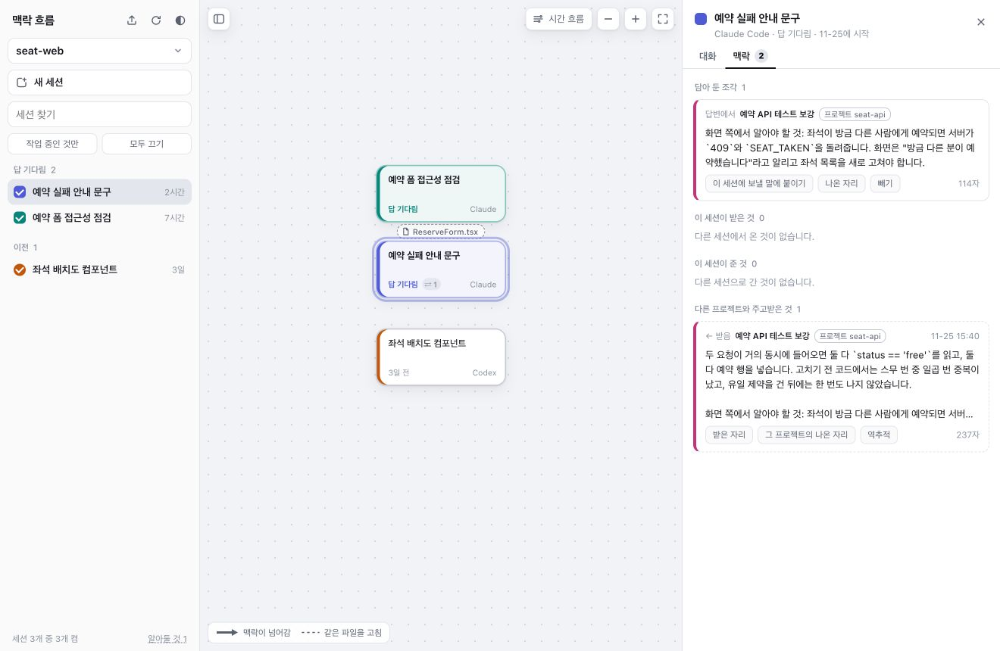

'다른 프로젝트와 주고받은 것'에 seat-api에서 받은 조각이 있습니다. 그 카드의 **역추적**을 누릅니다.

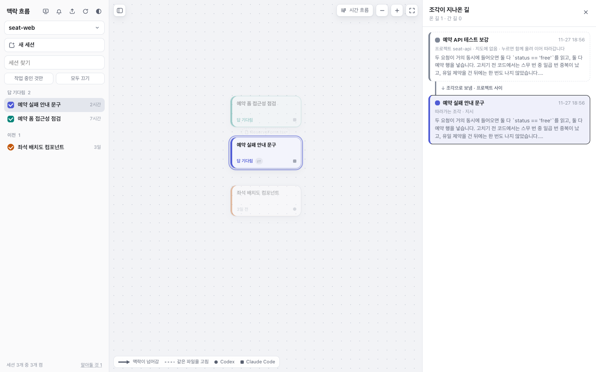

길이 seat-api 앞에서 멈추고, 점선 카드가 "프로젝트 seat-api · 지도에 없음 · 누르면 함께 올려 이어 따라갑니다"라고 말합니다. 그 카드를 누릅니다.

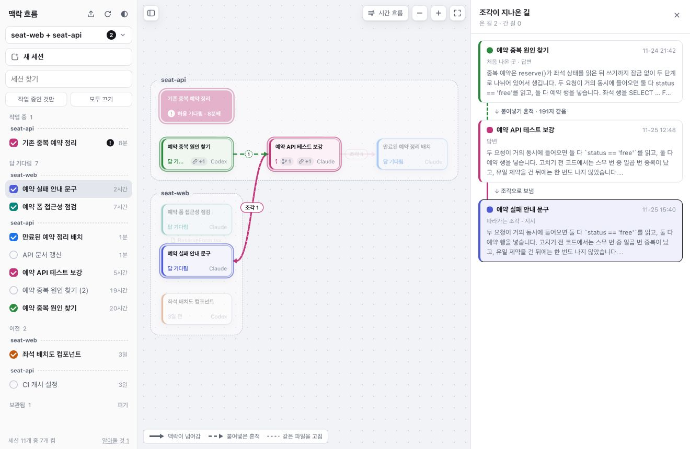

seat-api가 지도에 올라오고 길이 '예약 중복 원인 찾기'까지 이어집니다. 지도에 없는 것은 그리지 않되, 그 너머에 무엇이 있는지는 숨기지 않습니다.

## 7. 승인을 화면에서 받는다

'예약 중복 원인 찾기 (2)' 타일을 눌러 대화를 열고 "NOTES.md에 유일 제약을 건 이유를 한 줄 적어줘"라고 보냅니다. 데모 에이전트는 요청에 '적어', '고쳐', '수정'이 들어 있으면 작업 폴더의 `NOTES.md`에 한 줄을 적겠다고 허락을 구합니다.

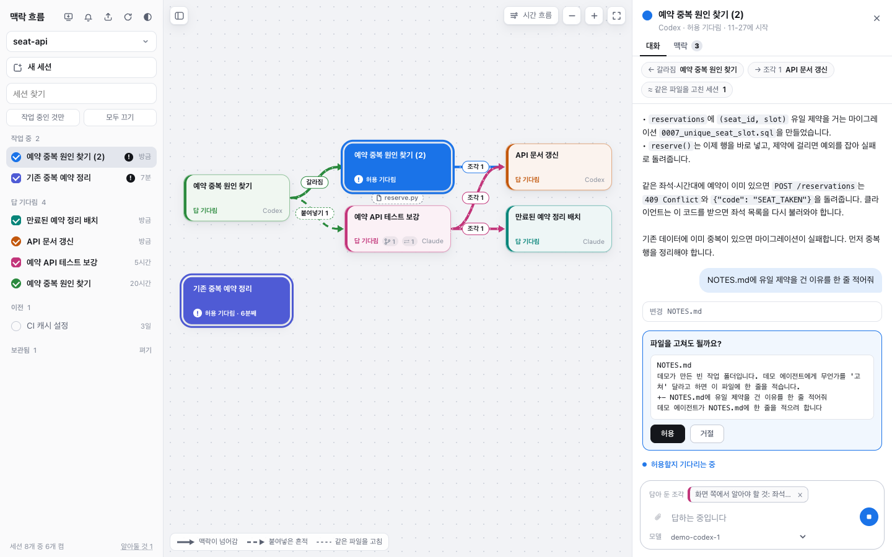

**보이는 것.** 대화에 "파일을 고쳐도 될까요?" 카드가 뜨고 바뀔 줄이 보입니다. 지도의 타일은 '허용 기다림'으로 바뀝니다. **허용**을 누르면 답이 "NOTES.md에 한 줄을 적었습니다"로 끝나고, 접힌 '작업 과정'에 고친 파일이 남습니다.

같은 것을 Claude Code 세션인 '예약 API 테스트 보강'에서 해 보고 이번에는 **거절**을 누릅니다. 답이 "허락을 받지 못해 NOTES.md는 고치지 않았습니다"로 끝납니다.

**왜 쓸모 있나.** 이 화면에서 이어 쓰는 대화는 그 세션의 권한 그대로 돕니다. 그래서 에이전트가 허락을 구하면 그 요청이 화면으로 옵니다. 실제 사용에서는 Codex의 파일 변경·명령 승인과 Claude Code의 도구 권한 요청이 이 카드로 옵니다.

1단계에서 본 '기존 중복 예약 정리'는 사정이 다릅니다. 그 세션은 다른 창에서 허락을 기다리므로 그 창에서 답해야 합니다. 데모에서는 `npm run demo:say -- dedupe "진행해"`로 그 창에서 답한 것처럼 할 수 있고, 그러면 타일의 '허용 기다림'이 풀립니다.

## 8. 조각으로 새 세션을 시작한다

입력칸 위의 칩을 끌어 지도의 빈 곳에 놓습니다.

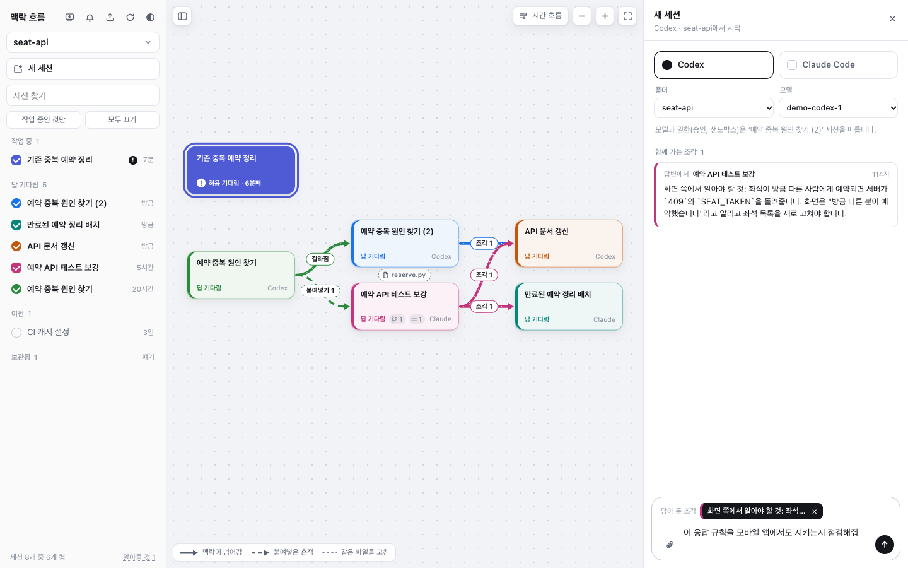

**보이는 것.** 새 세션 창이 열립니다. 클라이언트(Codex 또는 Claude Code), 일할 폴더, 모델을 고를 수 있고, 함께 갈 조각이 카드로 보입니다. 모델과 권한은 같은 클라이언트의 가까운 세션을 따릅니다. 첫 말을 적고 시작합니다.

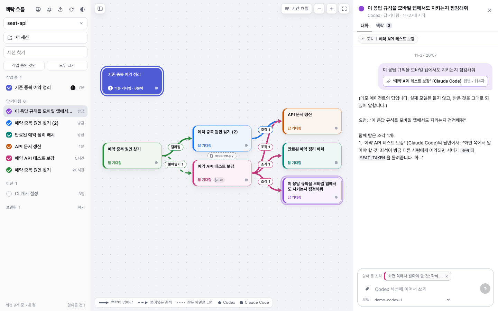

지도에 새 타일이 생기고, 조각이 나온 세션에서 새 세션으로 실선이 그어집니다. 목록 위의 **새 세션** 단추로는 조각 없이도 시작할 수 있습니다.

**왜 쓸모 있나.** 한 세션에서 나온 결론을 들고 새 일을 시작하는 경우가 많습니다. 새 세션이 무엇을 받고 태어났는지가 처음부터 지도에 남습니다.

## 9. 보낸 말을 고쳐 다시 보낸다

4단계에서 'API 문서 갱신'에 보낸 요청으로 돌아갑니다. 그 대화를 열고 "이 내용도 문서의 오류 응답 절에 반영해줘" 말풍선에 마우스를 올리면 오른쪽 위에 **고쳐 보내기**가 뜹니다. 누릅니다.

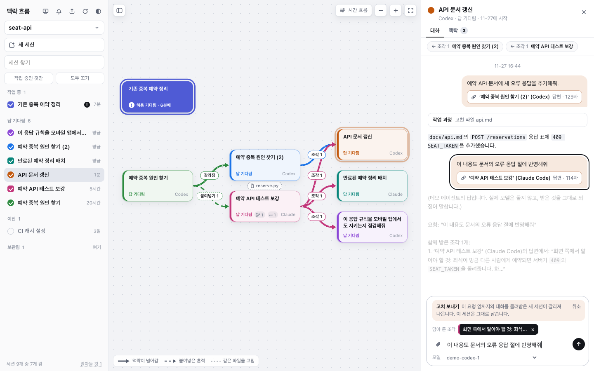

**보이는 것.** 원래 친 글이 입력칸에 들어오고, 그 말에 붙어 갔던 조각이 다시 붙습니다(검은 칩). 고칠 요청에는 테두리가 생기고 그 아래의 말들은 흐려집니다. 새 세션이 모르게 될 부분입니다. 입력칸 위의 띠는 보내면 무슨 일이 생기는지 말해 줍니다. 띠의 '취소'나 Esc로 그만둘 수 있습니다.

글을 "이 내용은 오류 응답 절 말고 '자주 묻는 질문' 절에 넣어줘"로 바꿔 보냅니다.

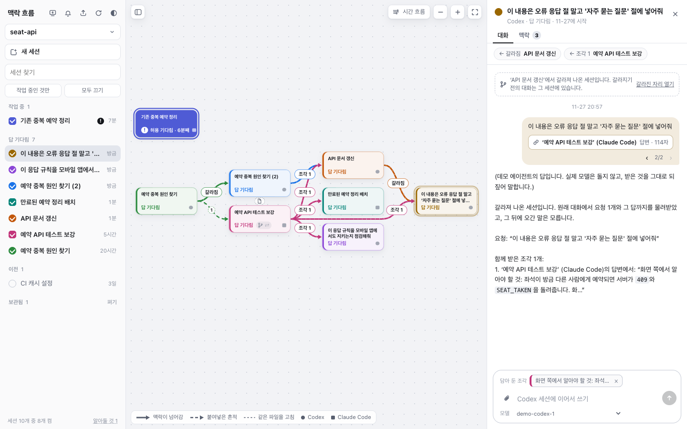

**보이는 것.** 새 세션의 대화가 열립니다. 지도에는 'API 문서 갱신'에서 새 타일로 가는 실선 **갈라짐**이 생기고, 조각이 나온 세션에서도 실선 **조각 1**이 옵니다. 데모 에이전트의 답은 "갈라져 나온 세션입니다. 원래 대화에서 요청 1개와 그 답까지를 물려받았고, 그 뒤에 오간 말은 모릅니다"로 시작합니다. 'API 문서 갱신'을 다시 열어 보면 대화가 그대로입니다. 고치기 전의 요청과 그 답이 남아 있습니다.

새 세션의 답에 마우스를 올리면 **다시 받기**가 있습니다. 누르면 같은 요청을 같은 조각과 함께 한 번 더 갈라 보냅니다.

**왜 쓸모 있나.** 요청을 잘못 썼거나 답이 마음에 들지 않을 때 그 위에 말을 덧붙이면, 틀린 요청과 그 답이 대화에 남아 다음 답에 섞여 듭니다. 고쳐 보내면 그 요청이 없던 자리에서 다시 시작합니다. 채팅 앱은 이때 원래 말을 화면에서 치우는데, 여기서는 원래 세션을 그대로 두고 갈라 냅니다. 이 도구는 클라이언트의 기록을 읽기만 하고, 무엇이 무엇에서 나왔는지를 남기는 것이 이 도구의 일이기 때문입니다. 어느 요청을 어떻게 고쳐 봤는지가 지도에 갈래로 남습니다.

세션의 첫 요청을 고치면 물려받을 대화가 없습니다. 그때는 갈라짐 없이 같은 폴더와 모델의 새 세션으로 시작하고, 띠가 그렇게 알려 줍니다. 1단계의 'API 문서 갱신'에 처음부터 있던 요청으로 해 볼 수 있습니다.

## 10. 더 해 볼 것

**알림.** 대화창을 닫고 다른 터미널에서 `npm run demo:say -- docs "예시도 넣어줘"`를 쳐 봅니다. 지도 오른쪽 위에 카드가 뜨고, 누르면 그 세션의 대화가 열립니다. 브라우저의 다른 탭을 보는 동안 같은 명령을 치면 이 탭의 제목이 `(1) 맥락 흐름`으로 바뀝니다. 왼쪽 위 종 단추에서 '안 보고 있을 때 시스템 알림도'를 켜면 운영체제의 알림으로도 옵니다. 세션을 여럿 돌려 놓고 다른 일을 하다가, 끝난 세션과 나를 기다리는 세션을 놓치지 않게 하려는 것입니다.

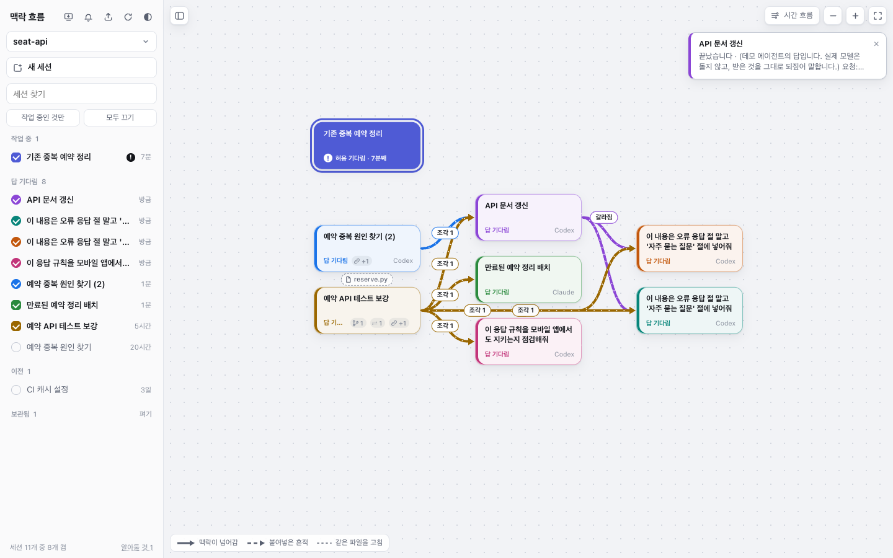

**그림과 파일, 모델.** 대화의 입력칸 왼쪽 클립 단추로 그림이나 파일을 붙이고(붙여넣기와 끌어다 놓기도 됩니다), 입력칸 아래 '모델'에서 다른 모델을 골라 보냅니다. 데모 에이전트의 답이 받은 그림의 종류와 크기, 파일을 읽을 수 있는지, 어느 모델로 답했는지를 되짚습니다. 보낸 그림은 대화에 작게 남고 누르면 크게 보입니다. 그 요청을 고쳐 보내면(9절) 그림과 파일도 입력칸에 다시 붙습니다.

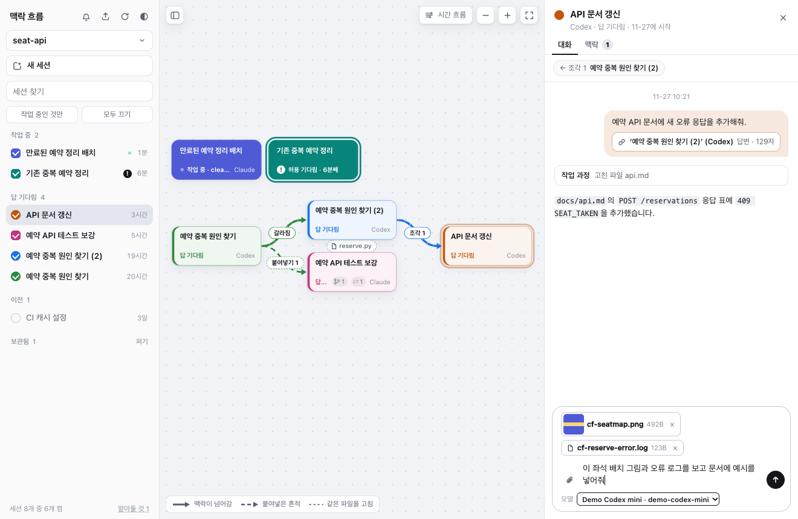

**가까이, 멀리.** 지도 오른쪽 위의 − 와 + 로 세 단계를 오갑니다. 가까이 가면 세션마다 마지막 요청과 요청·변경 수가 보이고, 선에는 넘어간 조각의 첫머리가 붙습니다. 글자 크기는 어느 단계에서나 같습니다.

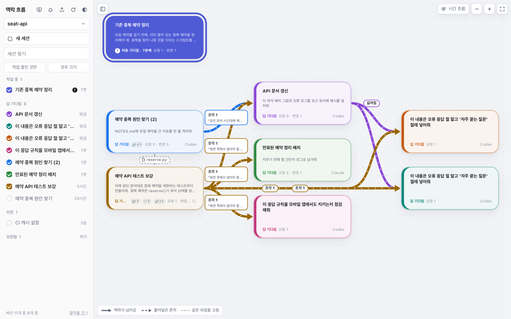

**시간 흐름.** 오른쪽 위의 '시간 흐름'을 누르면 지도 아래에 서랍이 열립니다. 세션마다 한 줄이고, 언제 요청이 있었고 언제 조각이 넘어갔는지가 시간 축에 놓입니다. 표식을 누르면 그 대화의 그 자리로 갑니다.

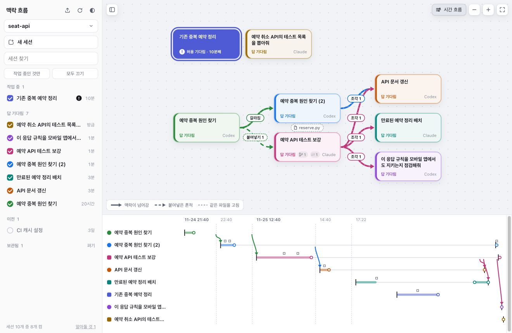

**찾기.** 목록 위 '세션 찾기'에 `SEAT_TAKEN`을 쳐 봅니다. 세션 이름뿐 아니라 대화의 글에서도 찾고, 누르면 그 자리가 열립니다.

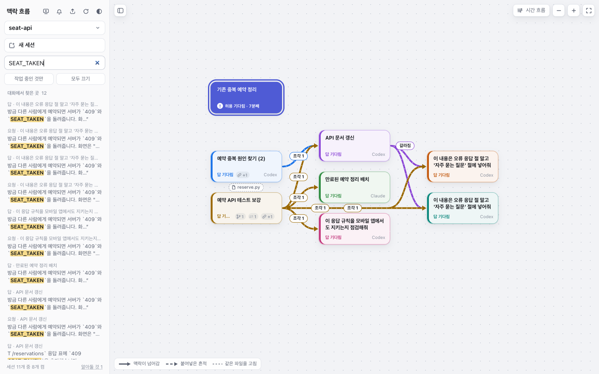

**내보내기.** 왼쪽 위의 내보내기 단추를 누르면 지도에 켠 세션을 한 파일로 내보냅니다. '화면 파일(.html)'은 서버 없이 두 번 눌러 여는 읽기 전용 화면입니다. 자세한 것은 [EXPORT.md](EXPORT.md)에 있습니다.

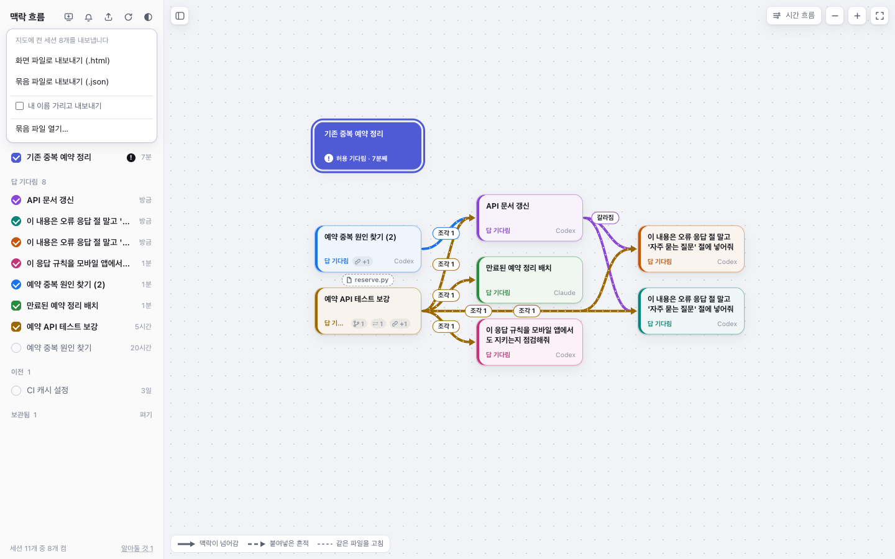

**그 밖에.** 타일을 끌어 옮기면 그 자리에 머물고 '자동 배치'로 되돌립니다. 왼쪽 위의 반달 단추는 밝은 화면과 어두운 화면을 바꿉니다.

## 끝내기

`npm run demo`를 돌린 터미널에서 Ctrl+C를 누릅니다. 데모가 만든 것은 모두 `demo/home`에 있고, 지워도 됩니다. 데모를 끈 뒤 그 탭을 새로 고치면 '서버가 꺼져 있습니다' 화면이 나옵니다. 데모를 다시 띄우면 그 탭이 저절로 돌아옵니다.

## 데모에서 진짜인 것과 대역인 것

| | 데모에서 | 실제 사용에서 |
|---|---|---|
| 기록을 읽고 선을 긋는 코드, 서버, 화면 | 실제 코드 그대로 | 같음 |
| 조각을 싣는 훅 | 저장소의 실제 훅 스크립트 | 같은 스크립트를 클라이언트가 부름 |
| 기록의 형식 | 두 클라이언트의 실제 형식 | 같음 |
| 세션의 내용 | 지어낸 이야기 | 내 세션 |
| 클라이언트 | `demo/agent.ts`가 같은 프로토콜로 대답 | Codex, Claude Code |
| 답하는 것 | 받은 것을 되짚는 대역. 모델 없음 | 그 세션의 모델 |
| '자기 창'에서 말하기 | `npm run demo:say` | 데스크톱 앱이나 터미널에서 직접 |
| 작업 중인 세션 | 데모가 쓴 상태 파일 | 클라이언트의 살아 있는 프로세스 |

실제 기록으로 쓰려면 [USAGE.md](USAGE.md)로 가세요.
