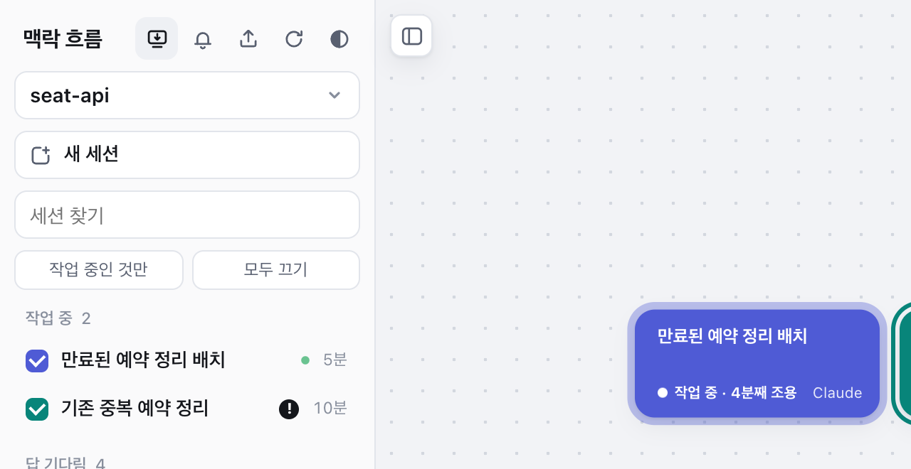
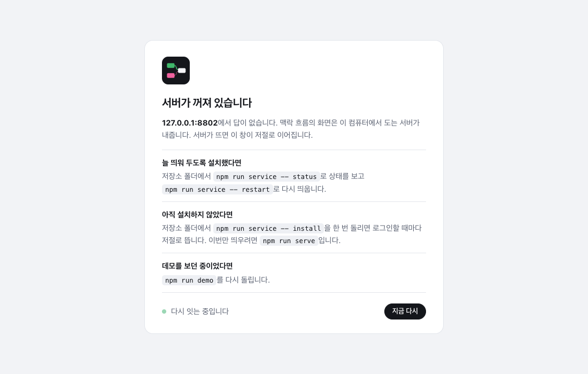

# 내 기록으로 쓰기

데모가 아니라 내 Codex·Claude Code 세션으로 쓰는 방법입니다. 지도를 보고 대화를 이어 쓰는 데에는 1절과 2절이면 됩니다. 다른 창에서 쓰고 있는 세션에 조각을 걸어 두려면 4절의 플러그인을 설치합니다.

## 0. 필요한 것

| | |
|---|---|
| 운영체제 | macOS에서 확인했습니다. Linux와 Windows는 확인하지 않았습니다 |
| Node.js | 23.6 이상. TypeScript를 빌드 없이 바로 돌리고 내장 SQLite를 씁니다 |
| Codex | 데스크톱 앱. 프로젝트 목록을 앱의 사이드바에서 가져옵니다. CLI(`codex`)도 함께 읽습니다 |
| Claude Code | 있으면 같은 폴더의 세션을 함께 읽습니다 |

이 도구가 읽는 곳은 `~/.codex`와 `~/.claude`이고, 둘 다 읽기만 합니다. 쓰는 곳은 `~/.context-flow` 하나입니다(6절).

## 1. 띄우기

```sh
npm install
npm run build          # 화면을 빌드합니다
npm run serve          # http://127.0.0.1:8801
```

포트를 바꾸려면 `npm run serve -- --port 9000`. 서버는 127.0.0.1에만 열리고, 이 컴퓨터의 그 화면에서 온 요청만 받습니다.

브라우저로 `http://127.0.0.1:8801`을 열고 왼쪽 위에서 프로젝트를 고릅니다. 주소로 바로 열 수도 있습니다.

```
http://127.0.0.1:8801/?project=<프로젝트 이름>
http://127.0.0.1:8801/?project=<이름>,<이름>        # 여러 프로젝트를 한 지도에
```

프로젝트는 이름, id, 폴더 경로 어느 것으로 적어도 됩니다.

화면을 열지 않고 무엇이 읽히는지만 보려면 다음을 돌립니다. 세션, 항목, 연결의 수와 읽는 데 걸린 시간이 나옵니다.

```sh
npm run scan -- <프로젝트 이름>
```

### 프로젝트와 세션이 정해지는 법

- **프로젝트**는 Codex 데스크톱 앱 사이드바의 프로젝트입니다. 이름과 폴더를 거기서 가져옵니다.
- **Codex 세션**은 앱이 그 프로젝트에 넣어 둔 스레드, 그리고 작업 폴더가 프로젝트 폴더 아래인 스레드입니다. Codex가 승인 검토용으로 스스로 돌리는 스레드는 뺍니다.
- **Claude Code 세션**은 작업 폴더가 프로젝트 폴더 아래인 세션입니다. 서브에이전트는 주인 세션에 딸려 나옵니다.

## 2. 화면

화면은 세 칸입니다. 왼쪽이 세션 목록, 가운데가 지도, 오른쪽이 대화입니다.

### 세션 목록

| 있는 것 | 하는 일 |
|---|---|
| 프로젝트 단추 | 이름을 누르면 그 프로젝트만 봅니다. 이름 앞의 네모를 누르면 지금 지도에 함께 올리거나 내립니다 |
| 새 세션 | 새 세션 창을 엽니다. 담아 둔 조각을 붙여 시작할 수 있습니다 |
| 세션 찾기 | 세션 이름과 대화의 글에서 찾습니다. 찾은 곳을 누르면 그 대화의 그 자리가 열립니다 |
| 작업 중인 것만 | 작업 중인 세션과 거기 이어진 세션만 켭니다. 처음 상태입니다 |
| 모두 끄기 | 지도를 비웁니다 |
| 세션 줄 | 누르면 지도에 올리고 내립니다. 상태별로 묶여 있습니다 |
| 알아둘 것 | 읽지 못한 기록, 붙여넣기 선이 추정이라는 것 등을 적어 둡니다. 마우스를 올리면 나옵니다 |
| 위의 네 단추 | 알림, 내보내기와 불러오기, 기록 다시 읽기, 밝게·어둡게 |

세션의 상태는 넷입니다.

| 상태 | 뜻 |
|---|---|
| 작업 중 | 턴이 돌고 있다. '허용 기다림'이나 '입력 기다림'이 붙으면 사람을 기다리느라 멈춘 것이다. 2분 넘게 아무것도 적히지 않으면 'N분째 조용'이 붙는다 |
| 답 기다림 | 하루 안에 답을 내고 멈췄다. 다음 말을 기다린다 |
| 이전 | 하루 넘게 조용하다 |
| 보관됨 | 클라이언트에서 보관한 세션 |

### 지도

타일이 세션이고 선이 연결입니다. 선의 뜻은 [WHY.md의 3.2절](WHY.md#32-증거를-세-등급으로-나눠-다르게-그린다)에 있습니다.

| 하는 것 | 일어나는 일 |
|---|---|
| 타일 누르기 | 그 대화가 오른쪽에 열립니다 |
| 타일에 마우스 올리기 | 마지막 요청, 고치는 파일, 이어진 세션이 카드로 뜹니다 |
| 선이나 이름표 누르기 | 그 선으로 넘어간 것이 오른쪽에 열립니다 |
| 타일 끌기 | 그 자리로 옮겨지고 머뭅니다. '자동 배치'로 모두 되돌립니다 |
| 빈 곳 끌기, 휠 | 지도를 옮기고 확대합니다 |
| − 와 + | 세 단계로 확대합니다. 멀리서는 이름과 선만, 가까이서는 마지막 요청과 넘어간 조각까지 보입니다 |
| 맞추기 단추 | 켠 세션이 한눈에 들어오게 맞춥니다 |
| 시간 흐름 | 지도 아래에 세션별 시간 줄을 폅니다 |

### 알림과 빠른 반영

서버가 두 클라이언트의 기록 폴더를 지켜보고 지금 보는 세션들의 기록 파일 크기를 1초마다 보다가, 기록이 바뀌면 화면에 알립니다. 화면은 그때 기록을 다시 읽습니다. 그래서 원래 창(Codex 앱, 터미널)에서 나눈 대화가 1~2초 안에 지도와 대화창에 올라옵니다. 탭이 가려져 있어도 같습니다. 타일을 끌고 있는 동안에는 손을 뗄 때까지 미룹니다.

다시 읽었을 때 달라진 것 가운데 두 가지를 알립니다.

| 알리는 때 | 알림의 말 |
|---|---|
| 작업 중이던 세션이 멈췄다 | 끝났습니다 · 마지막 답의 첫머리 |
| 세션이 사람을 기다리기 시작했다 | 허용을 기다립니다, 또는 질문에 답하기를 기다립니다 |

알림은 지도 오른쪽 위에 카드로 뜨고, 누르면 그 세션의 대화가 열립니다. 지금 열어 보고 있는 대화의 일은 알리지 않습니다. 이 창을 보고 있지 않은 동안 온 알림은 탭 제목에 `(2) 맥락 흐름`처럼 수로 남고, 카드는 돌아와서 볼 때까지 남아 있습니다. 서브에이전트가 끝난 것은 알리지 않습니다.

왼쪽 위의 종 단추에서 고릅니다.

| 고르는 것 | 처음 상태 | 하는 일 |
|---|---|---|
| 화면 안에서 알리기 | 켬 | 카드와 탭 제목의 수 |
| 안 보고 있을 때 시스템 알림도 | 끔 | 이 창을 보고 있지 않을 때 운영체제의 알림으로도 띄웁니다. 처음 켤 때 브라우저가 허용할지 묻습니다 |

기록이 말해 주지 않는 변화(클라이언트가 죽었다, 턴이 조용해졌다)는 30초마다 다시 읽어 찾습니다. 기록 폴더를 지켜볼 수 없는 환경에서는 전처럼 주기적으로 읽습니다. 30초마다, 작업 중인 세션이 있으면 12초마다, 걸어 둔 조각이 있으면 6초마다입니다. 이때는 탭이 보일 때만 읽습니다.

### 대화

대화 탭에는 요청이 오른쪽 말풍선으로, 턴을 닫은 답이 왼쪽 글로 나옵니다. 그 사이의 중간 말과 파일 변경은 '작업 과정' 한 줄로 접혀 있습니다. 위쪽 단추들은 이 세션과 이어진 세션으로 건너갑니다.

맥락 탭에는 담아 둔 조각, 이 세션이 받은 것, 준 것, 다음 말을 기다리는 조각, 다른 프로젝트와 주고받은 것이 나옵니다. 지도의 선과 같은 것을 목록으로 보는 자리입니다. 조각마다 '나온 자리', '받은 자리', '역추적'이 있습니다.

## 3. 조각을 넘기기

**담기.** 대화에서 글을 끌어 고르면 '담기'가 따라옵니다. 답변 하나를 통째로 담는 단추도 답변마다 있습니다. 담은 조각은 입력칸 위에 칩으로 남습니다. 바구니는 도구 전체에 하나라서 어느 프로젝트를 열든 같은 조각이 보입니다.

**붙여 보내기.** 받는 세션의 대화를 열고 칩을 눌러 붙인 뒤 말을 적어 보냅니다. Enter가 보내기, Shift+Enter가 줄바꿈입니다. 칩을 끌어 지도의 타일이나 목록의 줄에 놓아도 그 세션의 입력칸에 붙습니다. 보낸 뒤에도 조각은 바구니에 남아 다른 세션에 또 보낼 수 있습니다.

**그림과 파일.** 입력칸 왼쪽의 클립 단추로 고르거나, 입력칸에 붙여넣거나, 대화창에 끌어다 놓습니다. 한 번에 8개, 모두 합쳐 10MB까지입니다. 붙인 것은 말과 함께만 보낼 수 있습니다.

- 그림(PNG, JPEG, GIF, WebP)은 그림으로 갑니다. 모델이 직접 봅니다.
- 그 밖의 파일은 `~/.context-flow/uploads`에 두고, 어디 있는지를 말 뒤에 적어 보냅니다. 에이전트가 필요할 때 제 도구로 읽습니다. Claude Code에는 그 폴더를 읽어도 된다고 함께 알려 주므로 허락을 따로 묻지 않습니다.
- 보낸 뒤 대화에는 '그림 1개'와 파일 이름이 남습니다. 지난 대화의 그림을 다시 보여 주지는 않습니다.
- 그림과 파일은 훅으로 실어 보낼 수 없습니다. '다음 말에 싣기'는 조각만 겁니다.

**모델 바꾸기.** 입력칸 아래의 '모델'에서 다음 말에 답할 모델을 고릅니다. 고르지 않으면 그 세션이 쓰던 모델입니다. 바꿔 보내면 그 세션은 그 뒤로도 그 모델로 답합니다. 클라이언트에서 모델을 바꾼 것과 같습니다. 목록은 Codex가 내주는 모델, Claude Code의 짧은 이름(opus, sonnet, haiku), 그리고 지도의 세션들이 쓰던 모델입니다.

**고쳐 보내기와 다시 받기.** 요청 말풍선에 마우스를 올리면 '고쳐 보내기'가, 마지막 답에는 '다시 받기'가 뜹니다. 고쳐 보내기는 그 요청의 글과 붙어 갔던 조각을 입력칸으로 되돌려 놓습니다. 고쳐서 보내면 그 요청 앞까지의 대화를 물려받은 새 세션이 갈라져 나오고, 원래 세션은 그대로 남습니다. 다시 받기는 같은 요청을 그대로 한 번 더 갈라 보냅니다. 띠의 '취소'나 Esc로 그만둡니다.

- 지도에는 원래 세션에서 새 세션으로 가는 실선 '갈라짐'이 남습니다. 갈라져 나온 세션의 대화에는 그 세션에서 오간 말만 보이고, 물려받은 대화는 원래 세션에 있습니다.
- 갈라 내는 것은 그 세션의 클라이언트입니다. Codex는 스레드를 그 턴 앞에서 갈라 내고(`thread/fork`), Claude Code는 그 앞의 답까지만 이어받아 새 세션으로 시작합니다(`--fork-session`).
- 원래 세션이 다른 곳에서 작업 중이어도 됩니다. 원래 세션에는 아무것도 쓰지 않습니다.
- 함께 보냈던 그림과 파일은 따라가지 않습니다. 필요하면 다시 붙입니다. 그림이나 파일이 붙었던 요청의 '다시 받기'는 바로 보내지 않고 입력칸에서 멈춥니다.
- 세션의 첫 요청을 고치면 물려받을 대화가 없어서, 갈라짐 없이 같은 폴더·모델·권한의 새 세션으로 시작합니다.
- 턴 표시가 없는 옛 형식의 Codex 기록에서는 갈라 낼 자리를 알 수 없어 보내지 않고, 그렇다고 알려 줍니다.

**다음 말에 싣기.** 조각을 붙이면 보내기 옆에 '다음 말에 싣기'가 나옵니다. 누르면 조각이 그 세션 앞으로 걸리고, 그 세션에 다음 말을 칠 때 함께 갑니다. Codex 앱에서 치든 터미널에서 치든 이 화면에서 치든 같습니다. 4절의 플러그인이 있어야 합니다.

**새 세션.** 칩을 지도의 빈 곳에 놓거나 '새 세션'을 누릅니다. 클라이언트, 폴더, 모델을 고르고 첫 말을 적습니다. 폴더와 모델은 그 프로젝트의 세션들이 쓰던 것 가운데서 고르고, 모델을 고르면 그 모델을 쓰던 가까운 세션의 권한도 함께 따릅니다.

**역추적.** 고른 글이나 조각 카드의 '역추적'을 누르면 그 글이 지나온 길이 열립니다.

### 이 화면에서 이어 쓸 때의 규칙

- 답하는 것은 그 세션의 클라이언트입니다. Codex는 그 스레드의 마지막 턴이 쓰던 모델, 승인 정책, 샌드박스를 그대로 씁니다. Claude Code는 그 세션을 이어 붙이고 권한 요청을 화면으로 돌립니다.
- 에이전트가 허락을 구하면 대화에 카드가 뜹니다. 허용하거나 거절할 때까지 턴이 기다립니다.
- 다른 곳에서 작업 중인 세션에는 보낼 수 없습니다. 걸어 두기는 됩니다.
- Codex 데스크톱 앱이 열어 둔 스레드에는 이 화면에서 바로 보낼 수 없습니다. Codex는 스레드 하나에 쓰는 프로세스를 하나만 두기 때문입니다. 걸어 두고 앱에서 다음 말을 치면 됩니다.
- 여기서 보낸 말과 답은 그 세션의 기록에 그대로 이어 붙습니다. 그 세션을 원래 쓰던 창에서 계속 이어 갈 수 있습니다.

## 4. 플러그인 설치 (걸어 두기에 필요)

플러그인은 훅 하나입니다. 세션에 말을 칠 때마다 클라이언트가 이 훅을 부르고, 훅은 그 세션 앞으로 걸린 조각이 있을 때만 그것을 말에 얹습니다. 걸린 것이 없으면 아무 일도 하지 않고 끝납니다. 자세한 것은 [plugin/README.md](../plugin/README.md)에 있습니다.

### Codex

```sh
codex plugin marketplace add /이 저장소의 경로/plugin
codex plugin add context-flow@context-flow
```

그다음 훅을 한 번 승인합니다. 터미널에서 `codex`를 열고 `/hooks`를 쳐서 context-flow의 훅을 승인합니다. Codex는 승인하지 않은 훅을 부르지 않습니다.

데스크톱 앱에서 쓰려면 승인한 뒤 앱을 완전히 끝냈다가 다시 엽니다. 승인 전부터 앱에 올라 있던 스레드는 훅을 부르지 않기 때문입니다.

### Claude Code

```sh
claude plugin marketplace add /이 저장소의 경로/plugin
claude plugin install context-flow@context-flow
```

사용자 범위로 설치됩니다. 훅을 따로 승인하는 단계는 없습니다.

### 되는지 확인하기

화면이 플러그인의 상태를 읽어 말해 줍니다. 조각을 걸어 두었을 때 입력칸 위 띠에 다음 가운데 하나가 나옵니다.

| 띠의 말 | 뜻 | 할 일 |
|---|---|---|
| 이 세션에 다음 말을 치면 함께 갑니다 | 준비됨 | 그 세션에 말을 칩니다 |
| 플러그인을 설치해야 실립니다 | 그 클라이언트에 플러그인이 없다 | 위의 설치 명령 |
| 훅을 승인해야 실립니다 | Codex에서 아직 승인하지 않았다 | 터미널의 `/hooks` |
| 말을 했는데 실리지 않았습니다 | 걸어 둔 뒤 그 세션에 말이 갔는데 조각이 그대로다 | Codex 앱을 끝냈다 다시 엽니다 |

가장 확실한 확인은 시험용 세션 하나에 조각을 걸어 두고 그 세션에 아무 말이나 쳐 보는 것입니다. 몇 초 뒤 지도의 '대기 1'이 실선 '조각 1'로 바뀌면 됩니다.

### 지우기

```sh
codex plugin remove context-flow@context-flow
codex plugin marketplace remove context-flow
claude plugin uninstall context-flow@context-flow
claude plugin marketplace remove context-flow
```

## 5. 늘 띄워 두기 (macOS)

터미널이나 Codex 앱에서 띄운 서버는 그 터미널이나 앱을 닫으면 함께 꺼집니다. launchd에 맡기면 따로 남고 로그인할 때 다시 뜹니다.

```sh
npm run service -- install      # ~/Library/LaunchAgents/local.context-flow.server.plist 한 파일을 쓰고 등록합니다
npm run service -- status
npm run service -- restart      # 코어의 코드를 고친 뒤
npm run service -- uninstall    # 내리고 그 파일을 지웁니다
```

포트는 `--port N`으로 바꿉니다. 서버의 출력은 `~/.context-flow/server.log`에 쌓입니다. 서비스가 8801을 쓰는 동안 `npm run serve`를 같은 포트로 또 띄우면 겹칩니다.

### Dock의 앱으로 쓰기

서버가 늘 떠 있으면 화면을 앱으로 설치해 둘 수 있습니다. Dock에 아이콘이 생기고, 누르면 주소창과 탭이 없는 제 창으로 열립니다. 앱을 만드는 것은 브라우저라서 따로 받거나 빌드할 것이 없습니다.



| 브라우저 | 하는 법 |
|---|---|
| Chrome, Edge | `http://127.0.0.1:8801`을 열고 왼쪽 위 '맥락 흐름' 옆의 설치 단추를 누른 뒤, 브라우저가 묻는 창에서 '설치'를 누릅니다. 주소창 오른쪽의 설치 아이콘으로도 됩니다 |
| Safari | 같은 주소를 열고 메뉴 막대에서 파일 → Dock에 추가…를 고릅니다. 화면의 설치 단추가 이 길을 알려 줍니다 |

- 앱은 마지막에 지도에 올려 두었던 프로젝트로 열립니다.
- 끝났거나 나를 기다리는 세션의 수가 Dock 아이콘의 배지로도 붙습니다. 탭 제목의 수와 같은 것입니다.
- 설치 단추는 설치할 수 있을 때만 보입니다. 이미 앱 창 안이거나 Firefox처럼 앱으로 만들지 못하는 브라우저에서는 보이지 않습니다.
- 지울 때는 Chrome·Edge에서는 앱 창의 ⋮ 메뉴에서 제거를 고르고, Safari로 만든 것은 앱을 휴지통에 버립니다. 서버와 기록은 그대로입니다.

**서버가 꺼져 있을 때.** 앱 창에는 주소창이 없어서 브라우저의 오류 화면만으로는 무슨 일인지 알기 어렵습니다. 그래서 서버가 답하지 않으면 '서버가 꺼져 있습니다' 화면이 대신 뜨고, 위의 `service` 명령 가운데 무엇을 돌릴지 알려 줍니다. 서버가 뜨면 그 창이 저절로 원래 화면으로 돌아옵니다. 브라우저 탭에서도 한 번 열어 본 주소라면 똑같이 뜹니다.



데모(8802)도 같은 방법으로 설치되지만 주소가 달라서 다른 앱이 됩니다. 실제로 쓸 앱은 8801에서 설치합니다.

## 6. 무엇이 어디에 남나

`~/.context-flow/`

| 파일 | 내용 |
|---|---|
| `transfers.jsonl` | 이 도구로 보낸 조각. 한 줄에 하나, 더하기만 합니다 |
| `pending/<세션 id>/<조각 id>.json` | 그 세션의 다음 말을 기다리는 조각. 훅이 가져갑니다 |
| `basket.json` | 담아 둔 조각 |
| `pieces/<조각 id>.txt` | 훅이 다 싣지 못한 긴 조각의 전체 |
| `uploads/<보낸 때>/<파일>` | 이 화면에서 말과 함께 보낸 그림과 파일. 30일 뒤 지웁니다 |
| `node` | 서버가 도는 node의 경로. 훅이 같은 node로 돕니다 |
| `server.log`, `hook.log` | 서비스의 출력, 훅이 node를 찾지 못했을 때의 한 줄 |

조각의 원문이 `transfers.jsonl`과 `basket.json`에, 보낸 파일이 `uploads`에 들어 있습니다. 대화 기록만큼 민감하게 다뤄 주세요.

브라우저에는 옮긴 타일의 자리, 밝기, 마지막에 고른 클라이언트가 남습니다(localStorage).

모두 지우려면 서비스를 내리고(`npm run service -- uninstall`) 플러그인을 지운 뒤 `~/.context-flow` 폴더를 지웁니다. 클라이언트의 기록은 건드리지 않았으므로 되돌릴 것이 없습니다. 다만 이 화면에서 보낸 말과 조각은 그 세션의 기록에 남아 있습니다.

### 무엇이 밖으로 나가나

기록을 읽고 선을 긋는 일은 이 컴퓨터 안에서 끝나고, 어디로도 보내지 않습니다. 이 화면에서 말을 보내거나 조각을 넘기면 그 글은 그 세션의 클라이언트가 평소처럼 제 모델에 보냅니다. 그 세션에 직접 쳐서 보내는 것과 같습니다.

## 7. 환경 변수

평소에는 필요 없습니다. 시험하거나 경로가 다를 때 씁니다.

| 변수 | 뜻 | 기본값 |
|---|---|---|
| `CONTEXT_FLOW_HOME` | 이 도구가 쓰는 폴더 | `~/.context-flow` |
| `CONTEXT_FLOW_CODEX_HOME` | Codex의 기록 폴더 | `~/.codex` |
| `CONTEXT_FLOW_CLAUDE_HOME` | Claude Code의 기록 폴더 | `~/.claude` |
| `CONTEXT_FLOW_CODEX` | 이어 쓸 때 부르는 Codex 실행 파일 | 데스크톱 앱에 든 것, 없으면 `codex` |
| `CONTEXT_FLOW_CLAUDE` | 이어 쓸 때 부르는 Claude Code 실행 파일 | `claude` |
| `CONTEXT_FLOW_NODE` | 훅이 돌 node | 서버가 적어 둔 것 |

## 8. 문제 해결

| 증상 | 볼 것 |
|---|---|
| 프로젝트 목록이 비어 있다 | Codex 데스크톱 앱의 사이드바에 프로젝트가 있어야 합니다. `npm run scan`이 찾은 이름을 말해 줍니다 |
| 세션이 지도에 없다 | 목록에서 꺼져 있을 수 있습니다. 하루 넘게 조용한 세션은 처음에 꺼져 있습니다. 작업 폴더가 프로젝트 폴더 밖이면 그 프로젝트의 세션이 아닙니다 |
| '서버에 닿지 않습니다' 띠, '서버가 꺼져 있습니다' 화면 | 서버가 내려갔습니다. `npm run service -- status`로 보고, 설치돼 있지 않으면 `install`, 내려가 있으면 `restart`. 화면은 스스로 다시 잇습니다 |
| 설치 단추가 없다 | 이미 앱 창이거나, 그 브라우저에 이미 설치돼 있거나, 앱으로 만들지 못하는 브라우저입니다. Chrome·Edge·Safari에서 엽니다 |
| 보내기가 막혀 있다 | 그 세션이 다른 곳에서 작업 중입니다. 걸어 두기를 씁니다 |
| Codex 세션에 보냈더니 쓰는 프로세스가 이미 있다고 한다 | 데스크톱 앱이 그 스레드를 열어 두었습니다. 걸어 두고 앱에서 말을 칩니다 |
| 걸어 둔 조각이 실리지 않는다 | 4절의 표. Codex는 승인과 앱 다시 열기가 필요합니다 |
| 훅이 불리는데 아무 일도 없다 | `~/.context-flow/hook.log`. 훅이 node를 찾지 못하면 여기에 한 줄 남기고 말은 그대로 보냅니다 |
| 붙여넣기 선이 엉뚱하다 | 추정입니다. 선을 눌러 같은 구간을 직접 봅니다. 두 세션이 같은 파일의 글을 따로 인용했을 때도 잡힙니다 |
| 시스템 알림이 안 뜬다 | 종 단추의 둘째 칸이 켜져 있는지, 브라우저가 이 주소(127.0.0.1)의 알림을 허용했는지, macOS의 알림 설정에서 그 브라우저가 허용돼 있는지 봅니다. 시스템 알림은 이 창을 보고 있지 않을 때만 뜹니다 |
| '허용 기다림'이 안 뜬다 | Codex 데스크톱 창에서 기다리는 세션은 '작업 중 · N분째 조용'으로만 보입니다 |
| 긴 조각이 잘렸다 | 훅은 Claude Code에 9,000자, Codex에 40,000자까지 싣습니다. 넘치면 앞부분만 싣고 전체가 있는 파일의 경로를 적습니다 |

## 9. 개발

```sh
npm run check     # 타입 검사 (코어, 화면, 데모)
npm test          # 시험 50개. 모두 지어낸 기록으로 돕니다
npm run build     # 화면 빌드
```

화면을 고치면서 볼 때는 `packages/web`에서 `npx vite`를 돌리고, 서버는 따로 `npm run serve`로 띄웁니다. 코드가 어디에 있는지는 [ARCHITECTURE.md](ARCHITECTURE.md)에 있습니다.
