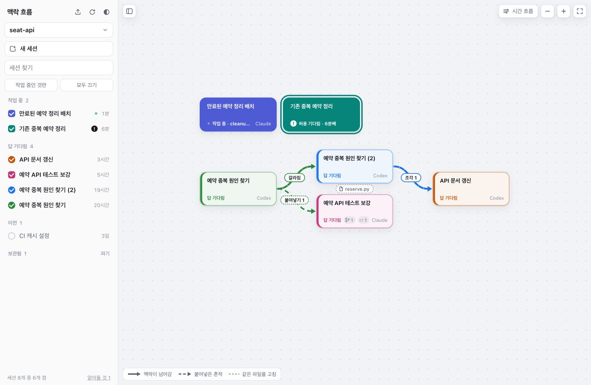
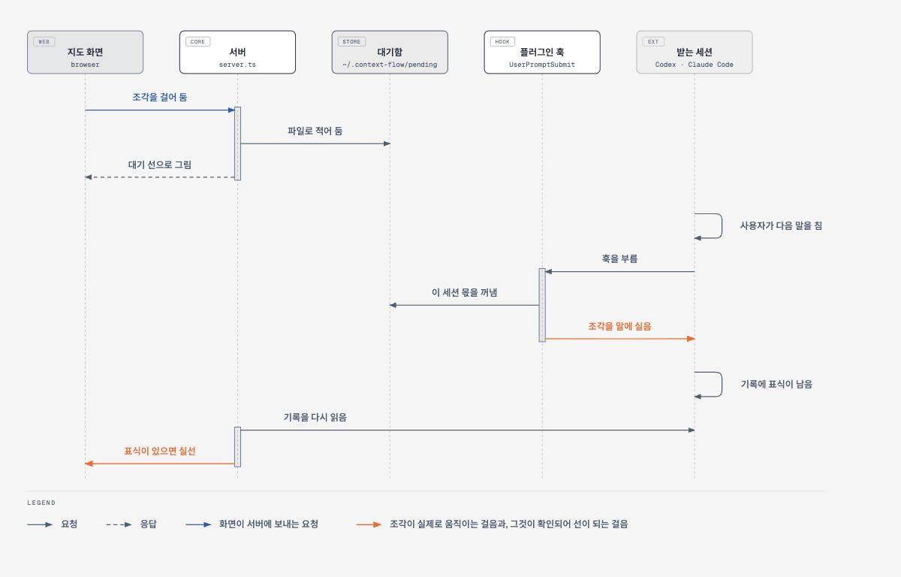

# 왜 만들었고, 왜 이렇게 만들었고, 무엇을 말해 주는가

이 문서는 세 가지에 답합니다. 어떤 질문에서 출발했는지, 그 질문에 왜 이 방법으로 답하려 했는지, 그래서 나온 지도를 어떻게 읽어야 하는지입니다. 직접 해 보는 것이 먼저라면 [DEMO.md](DEMO.md)부터 보세요.

## 1. 출발한 질문

코딩 에이전트를 쓰는 방식이 대화 하나에서 세션 여럿으로 바뀌었습니다. 원인을 찾는 세션, 고치는 세션, 테스트를 붙이는 세션, 문서를 고치는 세션이 한 프로젝트에서 함께 돕니다. 세션은 서로의 대화를 모릅니다. 그 사이를 잇는 것은 사람입니다. 한 세션의 답을 복사해 다른 세션에 붙이고, 하던 세션을 갈라 내고, 서브에이전트에게 일부를 맡깁니다.

세션이 대여섯을 넘으면 다음 세 질문에 답하기가 어려워집니다.

1. 지금 어느 세션이 무슨 일을 하고 있고, 어느 세션이 내 답을 기다리나.
2. 이 세션이 알고 있는 것은 어디서 왔고, 저 세션이 낸 결론은 어디까지 퍼졌나.
3. 이 결론만 골라 저 세션에 넘기려면 어떻게 하고, 넘겼다는 것은 나중에 어떻게 확인하나.

Codex와 Claude Code가 주는 것은 세션의 목록입니다. 목록은 세션을 최근 순으로 늘어놓을 뿐 세션 사이를 그리지 않습니다. 세션 사이에서 일어난 일은 사람의 기억에만 남습니다.

그래서 이 프로젝트는 두 가지를 묻습니다.

- **세션 사이에 맥락이 움직인 것을, 클라이언트가 이미 남기는 기록만으로 어디까지 그릴 수 있는가.**
- **그 그림 위에서 맥락을 직접 옮기게 하면, 옮긴 것이 그림에 그대로 남아 위의 세 질문에 답하기 쉬워지는가.**

여기서 맥락은 좁게 잡습니다. 한 세션에서 나온 글이 다른 세션의 입력이 된 것입니다. 답변의 한 문단, 변경의 몇 줄, 지시 하나가 모두 그 단위입니다. 이렇게 잡으면 맥락의 이동을 글자의 범위로 가리킬 수 있고, 가리킬 수 있어야 확인할 수 있습니다.

## 2. 먼저 확인한 것: 맥락은 실제로 어떻게 움직이나

방법을 정하기 전에 실제 기록을 세어 보았습니다. 대상은 개발자 한 사람이 한 달 동안 남긴 Codex 기록 474개이고, 아래는 그 집계입니다.

기록에 구조로 남는 이동이 있습니다. 다른 스레드에서 갈라져 나왔다고 적힌 기록이 44개, 서브에이전트가 19개, 다른 스레드가 만든 스레드가 12개였습니다. 이것들은 클라이언트가 적어 둔 것이라 읽기만 하면 됩니다.

구조로 남지 않는 이동도 있습니다. 사람이 손으로 복사해 옮긴 것입니다. 이것을 세려고, 사람이 직접 친 지시 824개를 다른 스레드의 앞선 답변·변경과 글자 단위로 견줬습니다.

| 잰 것 | 값 |
|---|---|
| 직접 친 지시 | 824개 |
| 그중 조상이 아닌 다른 스레드의 앞선 글과 80자 이상 같은 구간이 있는 지시 | 71개 (답변에서 66, 변경에서 5) |
| 그중 200자 이상 같은 것 | 43개 |
| 이렇게 이어진 스레드 쌍 | 41쌍, 그중 38쌍이 같은 폴더 |
| 같은 방법을 줄 전체가 똑같은 것만 찾도록 바꿨을 때 | 6개 |

이 숫자에서 세 가지를 읽었습니다.

첫째, 손으로 옮기는 맥락은 드문 일이 아닙니다. 지시 열두 개에 하나꼴로 다른 세션의 글이 들어 있었습니다. 그런데 이 이동은 어느 기록에도 "옮겼다"고 적히지 않습니다. 그리려면 찾아내야 합니다.

둘째, 옮김은 거의 같은 폴더 안에서 일어납니다. 지도의 단위를 프로젝트로 잡은 근거입니다.

셋째, 줄이 통째로 같은 것만 찾으면 71개가 6개로 줄어듭니다. 화면에서 복사한 글에는 굵게·코드·목록 같은 마크다운 기호가 빠져 있어서, 기록에 남은 원문과 줄 단위로는 맞지 않기 때문입니다. 글을 화면에 보이는 꼴로 펴서 견줘야 한다는 것을 여기서 알았습니다.

이 집계의 한계도 적어 둡니다. 한 사람의 한 달 기록입니다. 일치한 71건이 정말 사람이 복사해 옮긴 것인지 눈으로 검증하지 않았습니다. 파일에서 직접 복사한 글을 다른 세션의 답변이 인용하고 있었던 경우도 여기에 잡힙니다. 그러니 이 숫자는 규모의 감을 주는 것이고, 비율의 추정값으로 쓸 수는 없습니다.

## 3. 왜 이 방법인가

### 3.1 모델을 쓰지 않고 기록만 읽는다

두 세션이 비슷한 이야기를 하는지 모델에게 물어 선을 그을 수도 있었습니다. 그렇게 하지 않은 이유는 넷입니다.

- **같은 기록이면 언제 그려도 같은 지도가 나옵니다.** 어제 본 선이 오늘 사라지지 않습니다.
- **선마다 근거를 가리킬 수 있습니다.** 모든 선은 어느 세션의 어느 항목, 몇 번째 글자부터 몇 번째 글자까지를 가리킵니다. 선을 누르면 그 자리가 칠해져 나옵니다.
- **읽은 글이 컴퓨터 밖으로 나가지 않습니다.** 대화 기록에는 코드와 내부 사정이 그대로 들어 있습니다.
- **기다릴 것도 낼 것도 없습니다.** 세션 43개, 항목 1,285개인 프로젝트를 읽어 선을 긋는 데 0.6초가 걸렸습니다.

치르는 값도 분명합니다. 글자가 달라진 이동은 보지 못합니다. 결론을 자기 말로 요약해서 옮겼거나 말로 다시 설명한 것은 지도에 나오지 않습니다. 그래서 지도에 선이 없다는 것은 "근거를 찾지 못했다"는 뜻이고, "맥락이 움직이지 않았다"는 뜻이 아닙니다.

### 3.2 증거를 세 등급으로 나눠 다르게 그린다

세션 둘이 이어졌다고 말할 근거는 종류가 다르고, 믿을 수 있는 정도도 다릅니다. 한 가지 선으로 그리면 사실과 추정이 섞입니다. 그래서 셋으로 나눴습니다.

| 등급 | 무엇 | 어떻게 아나 | 지도에서 |
|---|---|---|---|
| 기록된 것 | 세션을 갈라 냄, 서브에이전트, 다른 스레드가 만든 스레드, 이 도구로 보낸 조각 | 클라이언트의 기록에 그렇게 적혀 있다 | 실선 화살표 |
| 찾아낸 것 | 사람이 손으로 붙여넣은 글 | 요청의 글이 다른 세션의 앞선 글과 같다 (3.4절의 규칙) | 긴 점선 화살표와 '붙여넣기 N'. 누르면 같은 구간이 나온다 |
| 겹침 | 두 세션이 같은 파일을 고침 | 두 세션의 변경 기록에 같은 파일이 있다 | 화살표 없는 짧은 점선과 파일 이름 |

위 지도에 세 가지가 모두 있습니다. '갈라짐'과 '조각 1'은 실선, '붙여넣기 1'은 긴 점선, 두 타일 사이의 `reserve.py`는 겹침입니다.

겹침을 화살표로 그리지 않은 데에는 이유가 있습니다. 같은 파일을 고쳤다는 사실은 누가 누구에게 무엇을 주었는지 말하지 않습니다. 화살표로 그리면 방향과 이동이 있었던 것처럼 읽힙니다. 다만 "이 둘은 서로를 알아야 할 수 있다"는 신호로는 쓸모가 있어서 지도에 남겼습니다.

### 3.3 조각의 단위는 (세션, 항목, 글자 범위)

항목은 세 가지입니다. 사람이 친 요청, 에이전트의 답변, 파일 변경입니다. 조각 하나는 어느 세션의 어느 항목에서 몇 번째 글자부터 몇 번째 글자까지인지, 그리고 그 원문입니다. 답변의 한 문장, 변경의 몇 줄, 답변 전체가 모두 같은 꼴입니다.

이 단위 하나를 세 군데서 씁니다. 사람이 대화에서 글을 골라 담을 때, 붙여넣기를 찾아 근거 구간을 적을 때, 조각이 지나온 길을 거슬러 갈 때입니다. 단위가 같아서 손으로 고른 조각과 찾아낸 붙여넣기를 한 길로 이을 수 있습니다.

화면은 마크다운을 벗겨서 그리므로, 화면에서 고른 자리를 원문의 범위로 되돌려 적습니다. 범위가 원문을 가리켜야 나중에 같은 자리를 다시 찾을 수 있습니다.

### 3.4 붙여넣기를 찾는 규칙과 그 이유

| 규칙 | 있는 이유 |
|---|---|
| 글을 화면에 보이는 꼴로 편 뒤 견준다. 마크다운 기호, 목록 표시, 링크의 주소, diff의 +/-, 겹친 빈칸을 뺀다 | 화면에서 복사한 글에는 이것들이 없다. 펴지 않으면 2절의 71건이 6건이 된다 |
| 32자 창이 맞는 곳에서 시작해 글자 단위로 늘려, 같은 구간 전체를 잡는다 | 근거를 "어디서 어디까지 같다"로 보여 주려면 구간이 필요하다 |
| 같은 글자가 합쳐 80자 이상이어야 한다 | 파일 이름이나 함수 이름처럼 짧은 일치는 우연히 생긴다 |
| 그 가운데 한 구간은 끊기지 않고 64자 이상이어야 한다 | 파일 경로와 짧은 코드 줄 여럿이 합쳐 80자를 넘는 경우가 실제 기록에서 붙여넣기로 잘못 잡혔다 |
| 요청보다 먼저 나온 글만 원천이 된다 | 나중에 나온 글을 붙여넣을 수는 없다 |
| 같은 세션, 그 세션의 서브에이전트, 갈라져 나오며 물려받은 대화는 뺀다 | 그 관계는 이미 기록된 선이 말한다 |
| 물려받은 대화는 갈라진 자리 앞까지다 | 요청을 고쳐 보내 갈라진 세션은 그 요청 앞까지만 안다. 그 뒤에 원래 세션이 한 말을 갈라진 세션에 붙여넣으면 맥락이 넘어간 것이다 |
| 물려받은 글을 다른 세션이 나중에 또 말했어도 그 세션에서 온 것으로 보지 않는다 | 갈라진 세션은 그 글을 처음부터 갖고 있었다 |
| 사람이 먼저 친 글을 에이전트가 되받아 말한 것은 뺀다 | 그 글의 원천은 에이전트가 아니라 사람이다 |
| 다섯 세션 이상의 답변에 똑같이 나오는 글은 뺀다 | 누구나 하는 말은 옮김의 흔적이 아니다 |
| 같은 글이 여러 곳에 있으면 가장 먼저 나온 곳을 원천으로 본다 | 그 뒤의 것들은 그것을 옮긴 것일 가능성이 높다 |

80, 64, 32, 5라는 숫자는 실제 기록 몇 프로젝트를 돌려 보며 눈으로 고른 값입니다. 정답을 따로 만들어 정밀도와 재현율을 재지는 않았습니다. 찾아낸 것을 기록된 것과 섞지 않고 점선으로 따로 그리는 것은 이 불확실함 때문입니다.

### 3.5 보낸 조각은 받은 쪽 기록에 표식이 있을 때만 실선이 된다

이 도구로 조각을 보내면 조각마다 id가 붙고, 받는 세션의 말 뒤에 `<context-piece id="…">` 표식에 싸여 실립니다. 도구는 무엇을 보냈는지 제 파일에 적어 둡니다. 그런데 그 파일만 보고 선을 긋지는 않습니다. 받은 세션의 기록에서 그 id를 찾았을 때만 실선을 긋습니다.

"보냈다"와 "도착했다"가 다르기 때문입니다. 훅이 승인되지 않았을 수 있고, 클라이언트가 긴 글을 잘랐을 수 있고, 사람이 그 세션에 끝내 말을 걸지 않았을 수 있습니다. 지도의 실선은 기록이 말하는 사실이어야 하므로, 도착하기 전의 조각은 끊어진 선과 '대기 N'으로 따로 보입니다.

### 3.6 조각을 건네는 두 길

조각을 다른 세션에 넣는 길은 둘입니다.

**이 화면에서 바로 보내기.** 대화창에 말을 쓰고 조각을 붙여 보내면, 도구가 그 세션의 클라이언트로 턴 하나를 시작합니다. Codex는 앱 서버 프로토콜로, Claude Code는 화면 없는 실행으로 붙습니다. 모델과 승인 정책은 그 세션이 마지막에 쓰던 것을 그대로 따릅니다.

**걸어 두었다가 다음 말에 싣기.** 위 그림의 길입니다. 받는 세션을 정해 조각을 걸어 두면, 사람이 그 세션에 다음 말을 칠 때 클라이언트가 부르는 훅(`UserPromptSubmit`)이 조각을 꺼내 그 말에 얹습니다. 데스크톱 앱에서 치든 터미널에서 치든 같습니다.

둘째 길을 만든 이유가 있습니다. 세션은 대개 다른 창이 쥐고 있습니다. Codex는 스레드 하나에 쓰는 프로세스를 하나만 두기 때문에, 데스크톱 앱이 열어 둔 스레드에는 밖에서 턴을 시작할 수 없습니다. 작업 중인 세션에 끼어드는 것도 맞지 않습니다. 훅은 사람이 그 세션에서 말할 때 따라가므로 누가 세션을 쥐고 있든, 세션이 무엇을 하던 중이든 됩니다.

훅 하나로 두 클라이언트를 맡을 수 있다는 것은 만들기 전에 확인했습니다. 두 클라이언트가 같은 꼴의 플러그인을 읽고, 훅의 사건 이름과 넘겨주는 값의 이름이 같습니다. 다른 점은 길이입니다. Claude Code는 훅이 더한 글이 10,000자를 넘으면 짧은 미리보기로 바꾸므로 9,000자에 맞추고, Codex에는 40,000자까지 싣습니다. 넘치는 조각은 앞부분만 싣고 전체를 파일로 둔 뒤 그 경로를 적습니다.

### 3.7 역추적이 따라가는 것

조각 하나를 고르면 뒤로는 그 글이 처음 나온 곳까지, 앞으로는 그 글이 간 곳까지 따라갑니다. 따라가는 규칙은 좁게 잡았습니다.

- 보낸 조각과 붙여넣기만 따라갑니다. 겹침은 맥락이 움직였다는 뜻이 아니므로 따라가지 않습니다.
- 세션에 들어온 글과 그 세션에서 나간 글이 32자 이상 같을 때만 한 길로 잇습니다. A에서 B로 간 조각과 B에서 C로 간 조각이 서로 다른 글이면, A의 글이 C까지 갔다고 말할 수 없기 때문입니다.
- 갈라짐은 앞으로만 따라갑니다. 갈라져 나온 세션은 갈라진 자리 앞까지의 대화를 통째로 갖고 갑니다. 요청을 고쳐 보내 갈라진 세션은 그 요청 앞까지만 알기 때문에, 그 뒤에 나온 글은 그 세션으로 따라가지 않습니다.
- 여섯 걸음에서 멈춥니다.
- 지도에 올리지 않은 프로젝트로 넘어가는 길은 그 앞에서 멈추고, 그 너머에 무엇이 있는지 말해 줍니다. 그 자리를 누르면 그 프로젝트를 올려 이어 따라갑니다. 지도에 없는 것을 그리지 않되, 있다는 것은 숨기지 않으려는 것입니다.

길 위에서도 등급은 유지됩니다. 붙여넣기로 이어진 걸음은 점선으로 남습니다.

### 3.8 '작업 중'을 아는 법

기록만으로는 턴이 열린 채 조용한 세션 셋을 구분할 수 없습니다. 오래 걸리는 명령을 돌리는 세션, 사람의 허락을 기다리는 세션, 클라이언트가 죽은 세션이 기록에서는 똑같이 보입니다.

그래서 기록에 더해 클라이언트의 살아 있는 프로세스를 봅니다. Claude Code는 프로세스마다 지금 무엇을 하는지(쉬는 중, 작업 중, 사람을 기다리는 중과 그 이유)를 작은 파일로 적어 둡니다. Codex는 스레드를 올려 둔 프로세스가 그 기록 파일을 열어 두므로, 턴이 시작되기 전부터 그 파일을 열고 있던 프로세스가 있으면 아직 작업 중으로 봅니다. 둘 다 읽기만 하고 클라이언트에 아무것도 묻지 않습니다.

'허용 기다림'을 따로 보이는 이유는 이것이 저절로 풀리지 않는 유일한 상태이기 때문입니다. 세션을 여럿 돌릴 때 가장 먼저 찾아야 하는 것이 사람이 가야만 움직이는 세션입니다.

### 3.9 지도의 꼴

화면은 채팅 앱의 꼴을 따랐습니다. 왼쪽에 세션 목록, 가운데에 지도, 오른쪽에 대화입니다. 세션을 고르는 것이 가장 중요한 일이므로 색은 세션을 가리키는 데에만 쓰고, 지도에는 글을 최소로 둡니다. 얼마나 가까이 보느냐에 따라 보이는 것이 세 단계로 늘어납니다.

자리는 정해진 규칙으로 잡습니다. 이어진 세션끼리 한 묶음이 되어 맥락이 흐르는 방향으로 왼쪽에서 오른쪽에 놓입니다. 힘으로 흩는 배치는 쓰지 않았습니다. 읽을 때마다 자리가 달라지면 어제 본 세션을 오늘 찾을 수 없기 때문입니다. 손으로 옮긴 타일은 그 자리에 머뭅니다.

여러 프로젝트를 한 지도에 올리면 프로젝트마다 테를 두르고, 프로젝트 사이의 조각은 테에서 테로 가는 보통의 실선이 됩니다. 선은 타일 뒤로 지나가지 않습니다. 그렇게 될 선만 타일을 돌아 직각으로 그립니다.

결정 하나하나와 택하지 않은 안은 [DESIGN.md](DESIGN.md)에 있습니다.

## 4. 결과를 어떻게 읽나

지도의 표시마다 말하는 것과 말하지 않는 것이 있습니다.

| 보이는 것 | 말하는 것 | 말하지 않는 것 |
|---|---|---|
| 실선 '갈라짐', 서브에이전트 표시 | 클라이언트의 기록에 그 관계가 적혀 있다 | 물려받은 대화 가운데 무엇이 실제로 쓰였는지 |
| 실선 '조각 N' | 받은 세션의 기록에 그 조각이 실려 있다. 그 턴의 입력에 들어갔다 | 에이전트가 그것을 읽고 따랐는지 |
| 끊어진 선 '대기 N' | 조각을 걸어 두었고 아직 그 세션에 말이 가지 않았다 | 언제 갈지 |
| 긴 점선 '붙여넣기 N' | 요청의 글이 다른 세션의 앞선 글과 그만큼 같다 | 사람이 정말 그 세션에서 복사했는지. 같은 파일에서 따로 복사했을 수도 있다 |
| 짧은 점선과 파일 이름 | 두 세션이 같은 파일을 고쳤다 | 서로를 알았는지, 고친 것이 부딪혔는지 |
| 선이 없음 | 위의 어느 근거도 찾지 못했다 | 맥락이 움직이지 않았다는 것. 요약해서 옮겼다면 보이지 않는다 |
| 채워진 타일 '작업 중' | 그 세션의 프로세스가 살아 있고 턴이 열려 있다 | 일이 나아가고 있는지 |
| '허용 기다림' | 클라이언트가 사람의 허락을 기다린다고 적었다 | Codex 데스크톱 창에서 기다리는 세션은 이렇게 잡히지 않고 '작업 중 · N분째 조용'으로 보인다 |
| 역추적의 '처음 나온 곳' | 읽은 기록 안에서 그 글이 가장 먼저 나온 곳 | 그 글의 진짜 출처. 지도에 없는 프로젝트나 기록 밖에서 왔을 수 있다 |

데모의 기록으로 1절의 세 질문에 답해 보면 이렇습니다.

1. **어느 세션이 무슨 일을 하고 누가 나를 기다리나.** 첫 화면에서 세션 둘이 작업 중이고 그중 '기존 중복 예약 정리'가 허락을 기다리며 몇 분째 멈춰 있다는 것이 보입니다. 세션 목록을 하나씩 열어 볼 필요가 없습니다.
2. **이 세션이 아는 것은 어디서 왔나.** 화면 프로젝트의 '예약 실패 안내 문구' 세션이 받은 조각을 거슬러 가면 API 프로젝트의 '예약 중복 원인 찾기' 세션에 닿습니다. 사이에 '예약 API 테스트 보강' 세션이 있고, 원인 분석이 그 세션으로 간 걸음은 사람이 손으로 붙여넣은 것이라 점선입니다. 두 프로젝트의 세션 열한 개 가운데 이 셋이 한 줄로 이어져 있다는 것은 대화를 읽어서는 알기 어렵습니다.
3. **골라 넘기고 확인하려면.** 답변의 한 문단을 골라 문서 세션에 붙여 보내면, 답이 그 조각을 받았다고 되짚고 지도에 실선이 생깁니다. 작업 중인 세션에는 걸어 두고, 그 세션의 창에서 다음 말을 치면 실선이 됩니다.

## 5. 쓸모에 대해 지금 말할 수 있는 것

말할 수 있는 것은 셋입니다.

- 실제 기록에서 선이 나옵니다. 개발에 쓴 실제 프로젝트 네 곳에서 붙여넣기 흔적이 적게는 1건, 많게는 43건 잡혔습니다.
- 조각을 건네는 두 길이 실제 Codex와 Claude Code에서 끝까지 됩니다. 무엇을 어떻게 확인했는지는 6절에 있습니다.
- 1절의 세 질문에 답하는 길을 누구나 데모로 다시 밟아 볼 수 있습니다.

말할 수 없는 것도 분명합니다. 사람이 이 지도로 세션을 더 빨리, 더 정확히 찾는지는 재지 않았습니다. 사용자 평가를 하지 않았기 때문입니다. 이 문서의 쓸모에 관한 말은 모두 사례와 데모에 기대고 있습니다.

평가를 한다면 쓸 수 있도록 내보내기를 만들어 두었습니다. 고른 세션의 한순간을 한 파일에 담아, 참가자 모두가 같은 기록을 같은 화면으로 보게 합니다([EXPORT.md](EXPORT.md)). 과제는 1절의 질문에서 바로 나옵니다. 예를 들어 "이 결론이 처음 나온 세션은 어디인가", "지금 사람을 기다리는 세션은 어느 것인가"를 세션 목록만 있을 때와 지도가 있을 때로 나눠 시간과 정답률을 재는 것입니다. 답안과 시간을 받는 화면, 평가 설계는 이 저장소에 없습니다.

## 6. 한계와 확인하지 못한 것

### 확인한 것 (2026-11-25, macOS)

자동 시험은 56개이고 모두 지어낸 기록으로 돕니다(`npm test`). 붙여넣기로 보는 것과 보지 않는 것, 세 세션에 걸친 길 따라가기, 프로젝트를 넘는 조각, 걸어 둔 조각을 가져가고 되돌리기, 글자 수를 지키는 이름 가리기, 타일과 테가 겹치지 않는 배치, 타일을 돌아가는 선, 알릴 것 찾기, 데모의 기록과 훅 전달, 기록이 바뀌면 화면에 알리는 것, 요청을 고쳐 갈라 보내는 것, 기록에서 그림을 꺼내는 것이 들어 있습니다.

실제 클라이언트로는 손으로 확인했습니다. 쓴 것은 Codex CLI 0.166.0, 데스크톱 앱에 든 Codex 엔진 0.171.0-alpha.13, Claude Code 2.1.331입니다.

- 걸어 둔 조각이 다음 말에 실리는 것. Codex 데스크톱 앱이 쥔 스레드에서는 훅을 승인하고 앱을 끝냈다 다시 연 뒤의 첫 말에 실렸습니다. Claude Code는 터미널에서 대화형으로 연 세션에서 실렸습니다. 두 쪽 모두 받은 세션의 기록에 표식이 남고 지도에 실선이 생겼습니다.
- 이 화면에서 이어 쓰기. 두 클라이언트에서 말 보내기, 답이 오는 대로 보이는 것, 승인 카드의 허용과 거절, 멈추기.
- 조각으로 새 세션 시작하기. 두 클라이언트 모두.
- 그림과 파일을 붙이고 모델을 바꿔 보내기. 두 클라이언트 모두 그림의 내용과 파일의 내용을 맞게 답했고, 허락을 따로 묻지 않았습니다(Claude Code 2.1.332, Codex 엔진 0.171.0-alpha.13.2, 2026-11-27).
- 보낸 요청을 고쳐 다시 보내기. 첫 턴에 낱말 하나를 알려 주고 둘째 턴에 잊으라고 한 세션에서 둘째 요청을 고쳐 보냈습니다. 두 클라이언트 모두 첫 턴만 아는 세션이 갈라져 나와 그 낱말을 답했고, 원래 세션의 기록은 그대로였습니다. 갈라진 세션의 첫 요청을 또 고쳐 보내도 같은 자리에서 갈라졌습니다(같은 판, 2026-11-27).
- 앱으로 설치하기. Chrome 158에서 화면이 설치 조건을 채우고 설치 단추가 뜨는 것, 설치하면 `~/Applications/Chrome Apps`에 '맥락 흐름' 앱이 아이콘과 함께 생기는 것, 그 앱을 띄우면 제 창(standalone)으로 열려 설치 단추가 사라지고 마지막에 보던 프로젝트로 열리는 것, 지우면 앱이 사라지는 것. 설치와 실행은 버릴 프로필의 Chrome을 디버깅 통로로 몰아서 했고, 앱을 창으로 여는 설정도 그 통로로 주었습니다. 서버를 내리면 '서버가 꺼져 있습니다' 화면이 뜨고, 다시 띄우면 그 창이 저절로 원래 화면으로 돌아왔습니다(2026-11-27).
- 갈라진 자리 읽기. 앞의 확인에서 실제로 갈라 낸 세션 여덟(Claude Code 넷, Codex 넷)이 모두 원래 세션의 맞는 요청 앞에서 갈라진 것으로 읽혔습니다. 갈라진 세션을 또 갈라 낸 것도 들어 있습니다.
- Codex 데스크톱 앱이 열어 둔 스레드 갈라 내기. 앱에 열어 둔 작은 스레드는 다른 프로세스가 이어 쓰려 하면 거절됩니다(`already has an active writer`). 같은 스레드에서 세션을 갈라 내는 것은 받아들여졌고, 갈라진 세션에서 턴이 끝까지 돌았고, 갈라진 세션은 원래 스레드의 요청을 차례대로 답했습니다. 원래 스레드의 기록은 한 바이트도 달라지지 않았습니다. 앱이 쓰고 있는 긴 스레드(기록 105MB)에서도 갈라 내기는 0.3초에 받아들여졌습니다.
- 앱에서 메시지를 고친 Codex 스레드 읽기. 위 확인에 쓴 스레드는 앱에서 둘째 메시지를 고친 것이었고, 그 전의 코드는 고친 턴 하나만 읽었습니다. 고친 뒤 이 컴퓨터의 프로젝트 19개를 다시 읽자 Codex 세션 442개 가운데 19개에서 가려져 있던 요청 532개가 보였고(요청이 67개로 보이던 세션이 140개가 된 것도 있습니다), 줄어든 세션은 없었습니다. 갈라진 자리를 아는 선이 20개에서 28개로, 붙여넣기 선이 70개에서 86개로 늘었고, 사라졌던 조각 선 하나가 돌아왔습니다. 그림은 71장 가운데 71장을 꺼냈습니다.
- 갈라진 자리를 지키는 붙여넣기 찾기. 이 컴퓨터의 프로젝트 19개에서 붙여넣기 선이 86개에서 88개가 되었습니다. 새로 잡힌 둘은 모두 원래 세션이 갈라진 자리보다 한참 뒤(3시간 반, 28시간 뒤)에 한 말을 갈라진 세션에 붙여넣은 것이고(같은 글 118자, 545자), 사라진 선은 없습니다.
- Claude Code에서 되감거나 요약한 대화 읽기. 시험 폴더에서 Claude Code 2.1.332로 세션을 만들어 둘째 요청 앞으로 되감고(`/rewind`, 그리고 헤드리스의 `--resume-session-at`), 맨 앞으로 되감고(세션 시작 훅이 있을 때와 없을 때), 'Summarize from here'와 'Summarize up to here', `/compact`를 해 보았습니다. 고치기 전에는 버려진 요청과 답이 대화에 그대로 나왔고 Claude Code가 쓴 요약이 사용자의 요청으로 읽혔습니다. 고친 뒤에는 Claude가 실제로 기억하는 턴만 남습니다(요청 9개로 읽히던 세션이 4개로). 그런 세션에서 요청을 고쳐 보내면 전에는 시작하지 못하고 끝났는데(`error_during_execution`), 고친 뒤에는 되감은 뒤의 요청, 요약 바로 뒤의 요청, 맨 앞으로 되감은 뒤의 요청에서 모두 갈라져 나와 그 자리까지의 낱말만 답했습니다. 요약보다 앞의 요청은 까닭을 적어 거절합니다. 이 컴퓨터의 프로젝트 19개에서 그 밖의 세션 510개(Claude Code 68개)는 요청·답·변경 수와 연결 수가 고치기 전과 같습니다(2026-11-27).
- 고치거나 되감기 전에 오간 말을 접어서 보기. 데모의 두 세션(Codex 앱에서 둘째 요청을 고친 것, Claude Code에서 되감은 것)에서 접힌 줄이 대화가 갈린 자리에 놓이고, 펼치면 그때의 요청·작업 과정·답이 나오고, 그 글을 골라도 담기 단추가 뜨지 않는 것을 헤드리스 브라우저로 확인했습니다. 이 컴퓨터의 프로젝트 19개에서는 세션 27개(Codex 23, 위에서 만든 Claude Code 시험 세션 4)에서 버려진 말 39토막(요청 43개, 답 13개)이 읽혔고, 모두 그 뒤의 요청 앞에 놓였습니다. 스냅숏의 항목 수는 19개 프로젝트 모두에서 전과 같고, 버려진 항목의 번호가 대화의 항목과 겹친 것은 없습니다(2026-11-27).
- 지난 대화의 그림 꺼내기. 이 컴퓨터의 프로젝트 19개에서 그림이 붙은 요청 44개, 그림 63장(Codex 61, Claude Code 2)을 모두 기록에서 꺼냈습니다. 한 요청에 그림이 넷 붙은 것, 데스크톱 앱에서 붙여넣은 것이 들어 있습니다. 긴 기록에서 처음 꺼낼 때 0.5초, 그다음은 1ms였습니다(2026-11-27).
- 프로젝트 둘과 셋을 한 지도에 올리고, 프로젝트를 넘는 조각을 선으로 보고 역추적으로 따라가기.
- 내보낸 화면에서 지도, 대화, 찾기, 역추적이 서버 없이 도는 것. 실제 기록에서 사용자 이름 560곳이 모두 가려지고 연결의 범위가 그대로인 것.
- 걸리는 시간. 세션 43개·항목 1,285개인 프로젝트 읽기 0.6초. 타일 70개·선 48개에서 배치 고르기 3ms, 선을 모두 돌려 그리기 18ms.

데모는 [DEMO.md](DEMO.md)의 모든 단계를 화면에서 따라 해 확인했습니다.

### 확인하지 못한 것

- Linux와 Windows, 터치 화면.
- 붙여넣기 찾기의 정확도. 잡힌 것이 실제로 사람이 복사해 옮긴 것인지는 몇 건만 눈으로 보았습니다.
- 훅이 실어 나른 프로젝트 사이의 조각, 그리고 받는 쪽이 Codex인 프로젝트 사이 전달. 프로젝트 사이 전달은 이 화면에서 바로 보내는 길로만 확인했습니다.
- 프로젝트 넷 이상을 함께 올린 화면.
- 내보낸 화면 파일을 두 번 눌러(file://) 여는 것. 서버가 내주는 같은 파일을 여는 것까지만 확인했습니다.
- Codex 데스크톱 앱을 끝낸 뒤에도 서비스로 띄운 서버가 남는지, 다시 로그인한 뒤 저절로 뜨는지.
- 실제 클라이언트로 도는 자동 시험은 없습니다. 실제 클라이언트 확인은 모두 손으로 했습니다.
- 되감은 대화를 읽는 규칙은 Claude Code 2.1.332에서 직접 만든 기록 네 개에서 읽어 낸 것입니다. 문서로 확인한 것이 아니고, 다른 판에서는 다를 수 있습니다. 실제 작업 기록에는 되감은 것이 하나도 없어서, 긴 작업 세션에서의 모습은 보지 못했습니다. 턴 중간으로 되감은 것(헤드리스에서만 됩니다)은 그 턴을 통째로 남깁니다.
- 기록 파일을 가리키는 규칙은 이 컴퓨터의 Codex 기록(엔진 0.171)에서 읽어 낸 것입니다. 문서로 확인한 것이 아니고, 다른 판에서는 다를 수 있습니다.
- Safari의 'Dock에 추가', Edge. Dock 아이콘의 배지가 실제로 보이는 모습. (Chrome의 설치 창으로 설치해 제 창으로 열리는 것은 쓰는 사람이 직접 확인했습니다.)
- 시스템 알림이 운영체제에 실제로 뜨는 모습. 화면이 알림을 만드는 데까지만 헤드리스 브라우저로 확인했습니다.

### 알려진 한계

- 글자가 달라진 이동은 보지 못합니다(3.1절).
- 프로젝트 목록을 Codex 데스크톱 앱의 사이드바에서 가져옵니다. Claude Code만 쓰는 환경에서는 프로젝트가 잡히지 않습니다.
- Codex 데스크톱 창에서 승인을 기다리는 세션은 '허용 기다림'으로 잡히지 않습니다.
- 데스크톱 앱이 열어 둔 Codex 스레드에는 이 화면에서 바로 보낼 수 없습니다. 걸어 두기를 씁니다.
- 훅을 설치하거나 승인하기 전부터 열려 있던 Codex 데스크톱 스레드는 앱을 다시 열어야 훅을 부릅니다.
- 프로젝트의 테는 손으로 옮길 수 없습니다. 돌려 그린 선은 타일만 피하고, 다른 선이나 이름표 위로는 지나갈 수 있습니다.
- 같은 지시를 여러 세션에 친 것(요청끼리 같은 글)은 연결로 잡지 않습니다.
- 고치거나 되감기 전에 오간 말은 보기만 합니다. 조각으로 담을 수 없고, 그 턴에서 고친 파일은 같은 파일 겹침에 세지 않습니다(되감을 때 코드까지 되돌렸는지는 기록만으로 알 수 없습니다). 내보낸 파일에는 들어가지 않고, 함께 갔던 그림은 장수만 보입니다.
- Claude Code가 대화를 요약한(`/compact`, 자동 요약) 자리보다 앞의 요청은 고쳐 보낼 수 없습니다. Claude Code가 요약 앞에서는 대화를 다시 잡지 못하기 때문입니다.
- 요청을 고쳐 보낼 때 다시 붙는 파일은 이 화면에서 보낸 것뿐입니다. 그림은 어디서 붙였든 다시 붙습니다.
- 내보낸 화면 파일에는 그림이 들어가지 않습니다.
- 사용자 평가를 하지 않았습니다(5절).
